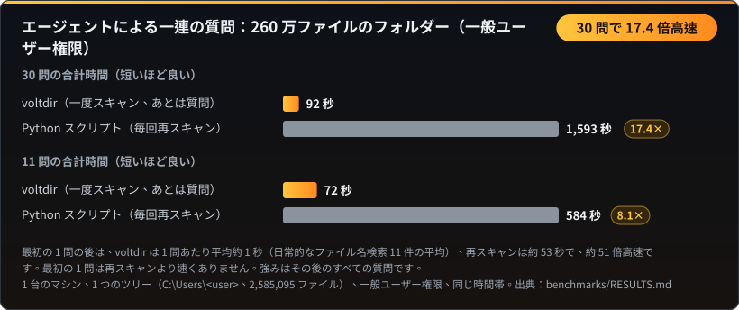
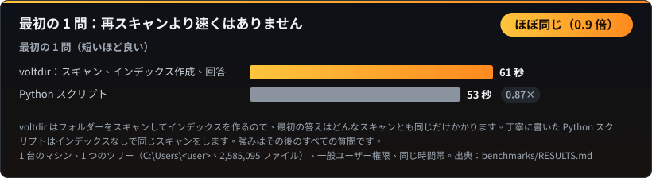
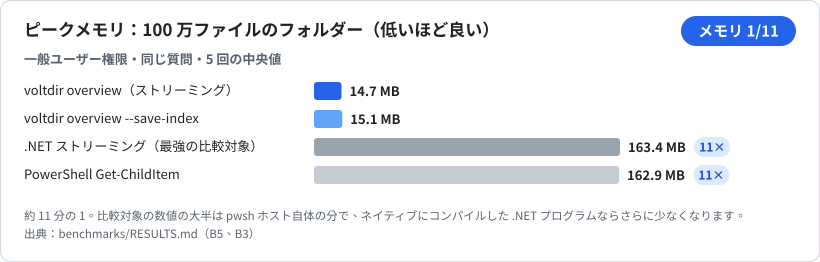
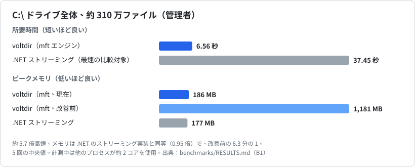
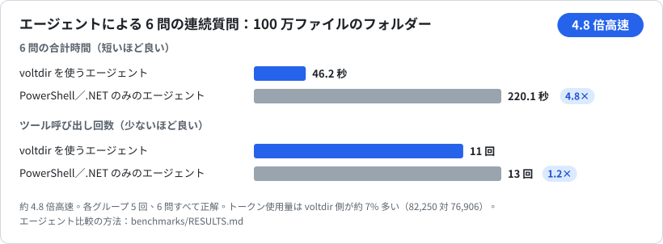
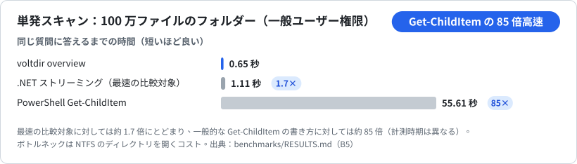
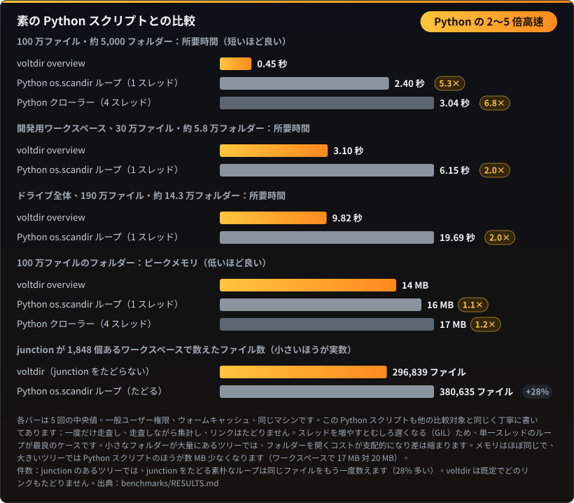

# ベンチマーク

← [README](README.ja.md) に戻る

以下の数値はすべて `benchmarks\` にある再現可能なベンチマークによるものです。各項目は 5 回計測の中央値で、計測中にバックグラウンドのプロセスが CPU を使っていた場合はノイズとして注記しています。

## 追加の質問：一度スキャンして、何度も質問する

260 万ファイルのフォルダー、一般ユーザー権限。最初の 1 問の後は、1 問あたり約 1 秒（日常的なファイル名検索 11 件の平均）。丁寧に書いた Python スクリプトで毎回再スキャンすると約 53 秒かかります。最初の 1 問は再スキャンより速くありません。数値：[`benchmarks/RESULTS.md`](benchmarks/RESULTS.md)。

## メモリ：100 万ファイルのフォルダー

voltdir は走査しながら集計します。フォルダーを走査し終えるとその結果を親に畳み込むため、ファイルごとの記録は保持しません。比較対象の 163 MB の大半は `pwsh` ホスト自体で、ネイティブにコンパイルした .NET プログラムならもっと少なくなります。

## C:\ 全体（管理者）

## エージェントによる連続した質問への回答

同じモデル、同じ質問、同じ権限で、各グループ 5 回実行し、すべて正解しました。差がつくのは追加の質問です。インデックスを保存しておけば 1 問あたり約 3〜8 秒、比較対象のエージェントは毎回 7〜33 秒かけて計算し直します。エージェント単位の比較にはエージェントの実行環境が必要で、手順は [`benchmarks/RESULTS.md`](benchmarks/RESULTS.md) に記載しています。

## 単発スキャン：100 万ファイルのフォルダー

## 素の Python スクリプトとの比較

数行の Python でもフォルダーは走査できるので、同じ速さだと思われがちです。実際にはそうではありません。100 万ファイルのフォルダーを voltdir は 0.45 秒で終えますが、素の `os.scandir` ループは 2.40 秒（5.3 倍の時間）かかり、スレッドを増やすと Python のグローバルインタープリターロック（GIL）のせいでむしろ遅くなります。開発用ワークスペースやドライブ全体では差は約 2 倍です。小さなフォルダーが大量にあると、時間の大半はファイルの読み取りではなくフォルダーを開くことに費やされ、そのコストはどのツールでも同じだからです。メモリはほぼ同じで、丁寧に書いた Python スクリプトも走査しながら集計します。

| フォルダー | ファイル数 | フォルダー数 | voltdir | 素の Python ループ | Python の所要時間 |
|---|---|---|---|---|---|
| ベンチマーク用フォルダー | 1,000,000 | 5,059 | 0.45 秒 | 2.40 秒 | 5.3 倍 |
| 開発用ワークスペース | 296,839 | 57,680 | 3.10 秒 | 6.15 秒 | 2.0 倍 |
| ドライブ全体 | 1,913,115 | 142,848 | 9.82 秒 | 19.69 秒 | 2.0 倍 |

**件数も正確です。** 約 1,800 個の junction があるこのワークスペースで、一般的な Python の `os.scandir` ループは voltdir より 28% 多くファイルを数えました（380,635 個。voltdir は 296,839 個）。junction の中にまで入り込み、同じファイルをもう一度数えるためです。voltdir は既定で junction をたどらず、ハードリンクされたデータは実サイズに一度だけ加算します。自分で確かめるには、`voltdir overview <フォルダー>` と `voltdir overview <フォルダー> --follow-links junction` を比べてください。後者のほうが大きい数字になります。
