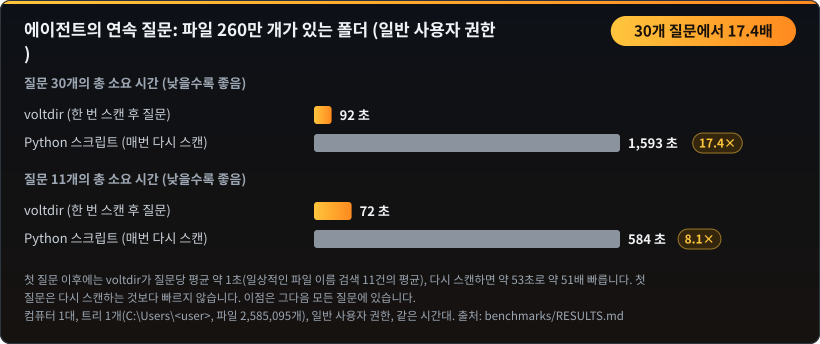
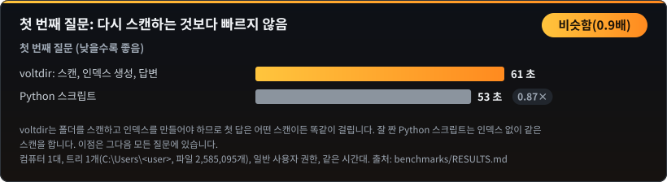
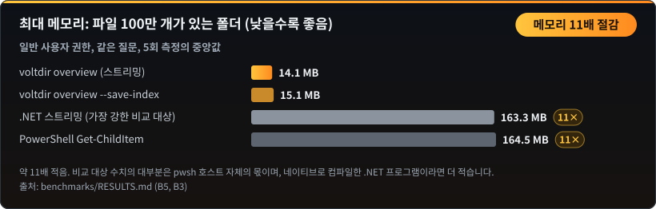
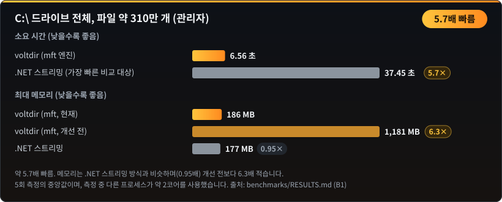
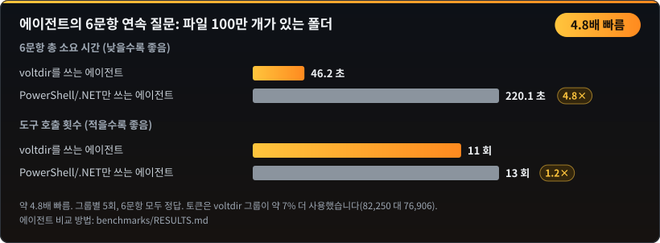
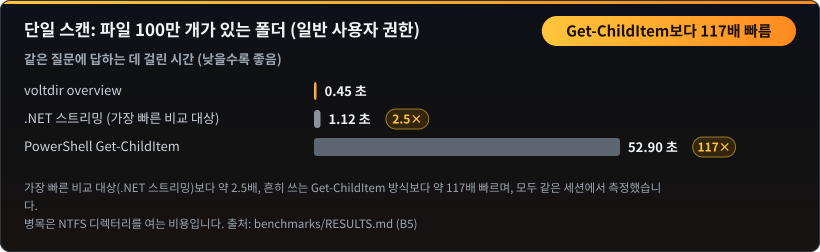
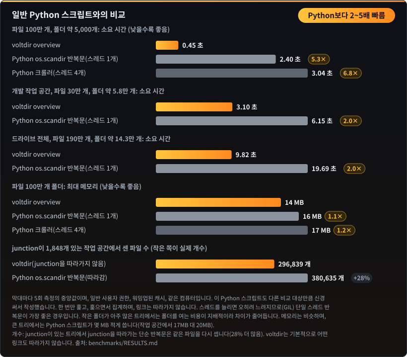

# 벤치마크

← [README](README.ko.md)로 돌아가기

아래 수치는 모두 `benchmarks\`의 재현 가능한 벤치마크에서 나온 것입니다. 각 항목은 5회 측정의 중앙값이며, 측정 중 백그라운드 프로세스가 CPU를 쓰고 있었다면 노이즈로 표시했습니다.

## 후속 질문: 한 번 스캔하고, 여러 번 질문하기

파일 260만 개가 든 폴더, 일반 사용자 권한. 첫 질문 이후에는 질문당 약 1초(일상적인 파일 이름 검색 11건의 평균)이고, 잘 짠 Python 스크립트로 매번 다시 스캔하면 약 53초입니다. 첫 질문은 다시 스캔하는 것보다 빠르지 않습니다. 수치: [`benchmarks/RESULTS.md`](benchmarks/RESULTS.md).

## 메모리: 파일 100만 개가 든 폴더

voltdir는 탐색하면서 바로 집계합니다. 폴더 하나를 다 돌면 그 결과를 상위 폴더에 합치므로 파일별 기록을 남기지 않습니다. 비교 대상의 163 MB는 대부분 `pwsh` 호스트 자체이며, 네이티브로 컴파일한 .NET 프로그램이라면 더 적을 것입니다.

## C:\ 전체 (관리자)

## 에이전트의 연속 질문 답변

같은 모델, 같은 질문, 같은 권한으로 그룹마다 5회씩 실행했고 모두 정답이었습니다. 차이는 후속 질문에서 납니다. 인덱스를 저장해 두면 질문 하나에 약 3~8초, 비교 대상 에이전트는 매번 7~33초를 들여 다시 계산합니다. 에이전트 단위 비교에는 에이전트 실행 환경이 필요하며, 방법은 [`benchmarks/RESULTS.md`](benchmarks/RESULTS.md)에 있습니다.

## 단일 스캔: 파일 100만 개가 든 폴더

## 일반 Python 스크립트와의 비교

Python 몇 줄이면 폴더를 훑을 수 있어서 같은 속도일 거라고 생각하기 쉽습니다. 실제로는 그렇지 않습니다. 파일 100만 개가 든 폴더를 voltdir는 0.45초에 끝내지만, 일반적인 `os.scandir` 반복문은 2.40초(5.3배 시간)가 걸리고, 스레드를 늘리면 Python의 전역 인터프리터 락(GIL) 때문에 오히려 더 느려집니다. 개발 작업 공간과 드라이브 전체에서는 차이가 약 2배입니다. 작은 폴더가 아주 많으면 시간 대부분이 파일을 읽는 일이 아니라 폴더를 여는 데 쓰이고, 그 비용은 어떤 도구든 같기 때문입니다. 꼼꼼하게 작성한 Python 스크립트도 훑으면서 집계하므로 메모리는 비슷합니다.

| 폴더 | 파일 수 | 폴더 수 | voltdir | 일반 Python 반복문 | Python 소요 시간 |
|---|---|---|---|---|---|
| 벤치마크 폴더 | 1,000,000 | 5,059 | 0.45초 | 2.40초 | 5.3배 |
| 개발 작업 공간 | 296,839 | 57,680 | 3.10초 | 6.15초 | 2.0배 |
| 드라이브 전체 | 1,913,115 | 142,848 | 9.82초 | 19.69초 | 2.0배 |

**개수도 정확합니다.** junction이 약 1,800개 있는 이 작업 공간에서 일반적인 Python `os.scandir` 반복문은 voltdir보다 파일을 28% 더 많이 셌습니다(380,635개, voltdir는 296,839개). 모든 junction 안으로 들어가 같은 파일을 다시 세기 때문입니다. voltdir는 기본적으로 junction을 따라가지 않고, 하드 링크된 데이터는 실제 크기에 한 번만 더합니다. 직접 확인하려면 `voltdir overview <폴더>`와 `voltdir overview <폴더> --follow-links junction`을 비교해 보세요. 뒤쪽이 더 큰 숫자를 냅니다.
