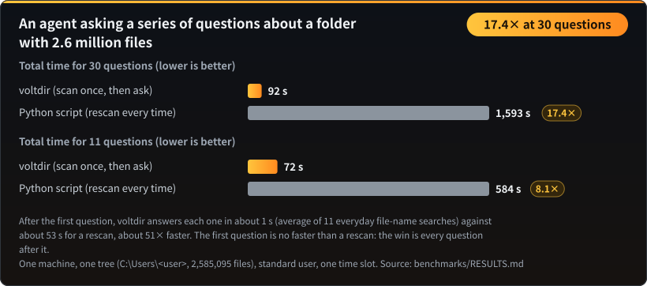
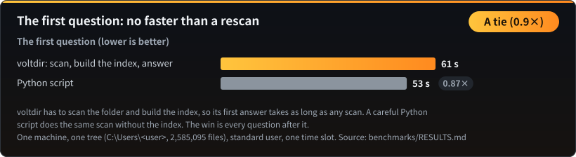
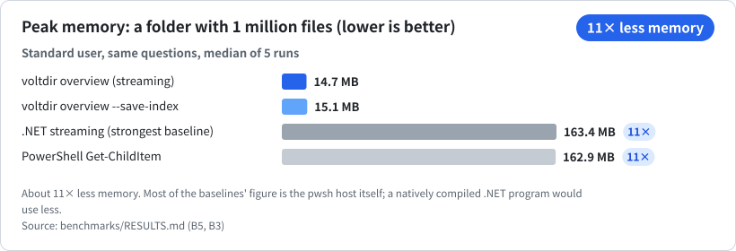
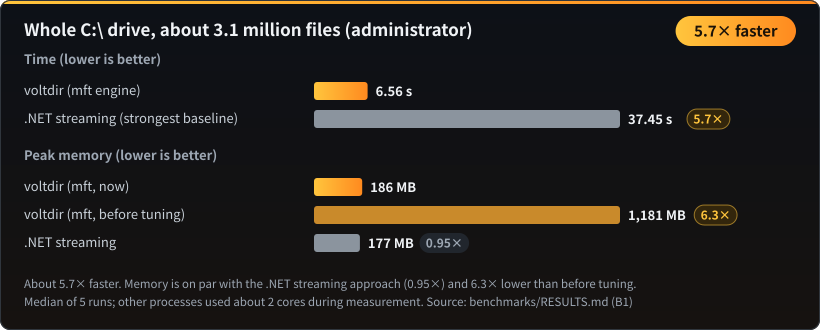
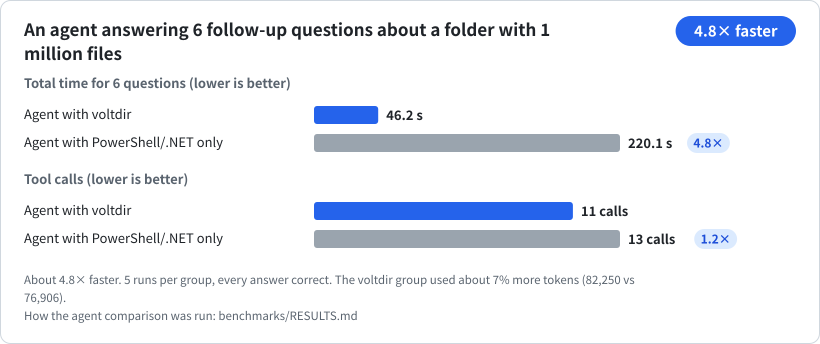
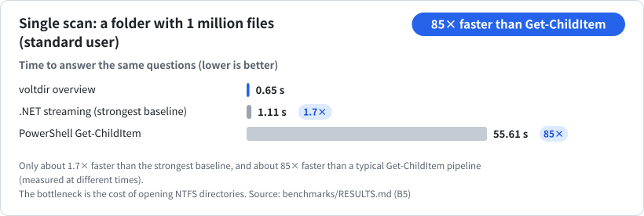
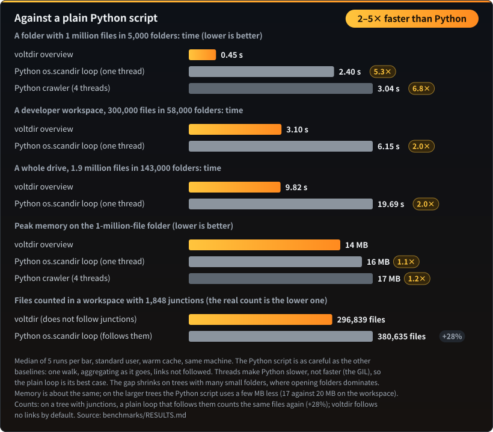

# Benchmarks

← Back to the [README](README.md)

Every number below comes from the reproducible benchmarks in `benchmarks\`. Each cell is the median of 5 runs, and runs measured while background processes were busy are flagged as noisy.

## Follow-up questions: scan once, ask many times

A folder with 2.6 million files, standard user. Each question after the first takes about 1 s (average of 11 everyday file-name searches) against about 53 s for a rescan with a careful Python script. The first question is no faster than a rescan. Numbers: [`benchmarks/RESULTS.md`](benchmarks/RESULTS.md).

## Memory: a folder with 1 million files

voltdir aggregates as it streams: once a folder is finished it is folded into its parent, so no per-file records are kept. Most of the baseline's 163 MB is the `pwsh` host itself; a natively compiled .NET program would use less.

## All of C:\ (administrator)

## An agent answering follow-up questions

Same model, same questions, same permissions, 5 runs per group, every answer correct. The gap comes from the follow-ups: with a saved index each one takes about 3–8 s, while the baseline agent spends 7–33 s recomputing. Agent-level runs need an agent harness; the method is described in [`benchmarks/RESULTS.md`](benchmarks/RESULTS.md).

## Single scan: a folder with 1 million files

## Against a plain Python script

A few lines of Python can walk a folder, so it is easy to assume they do the job just as fast. They do not. voltdir finishes a folder with 1 million files in 0.45 s; a plain `os.scandir` loop needs 2.40 s (5.3× as long), and adding threads makes it slower, not faster, because of Python's global interpreter lock. On a developer workspace and on a whole drive the gap is about 2×: with many small folders, opening the folders dominates the time rather than reading files, and that cost is the same for every tool. Memory is about the same, because a careful Python script also aggregates while it walks.

| Folder | Files | Folders | voltdir | Plain Python loop | Python takes |
|---|---|---|---|---|---|
| Benchmark folder | 1,000,000 | 5,059 | 0.45 s | 2.40 s | 5.3× as long |
| Developer workspace | 296,839 | 57,680 | 3.10 s | 6.15 s | 2.0× as long |
| Whole drive | 1,913,115 | 142,848 | 9.82 s | 19.69 s | 2.0× as long |

**The counts are right, too.** On that workspace, which contains about 1,800 junctions, a plain Python `os.scandir` loop counted 28% more files than voltdir (380,635 against 296,839): it walks into every junction and counts the same files again. voltdir does not follow junctions by default, and counts hard-linked data once toward physical size. To see it yourself, compare `voltdir overview <folder>` with `voltdir overview <folder> --follow-links junction`; the second gives the larger count.
