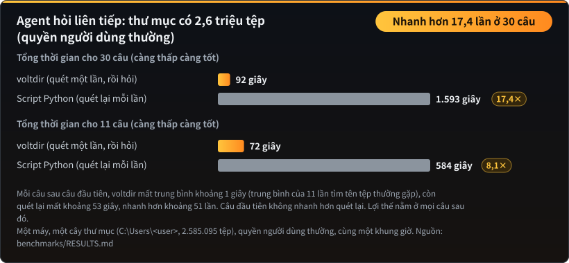
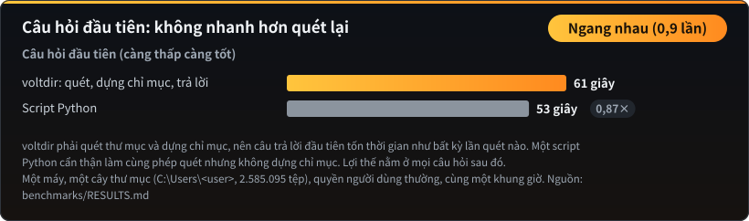
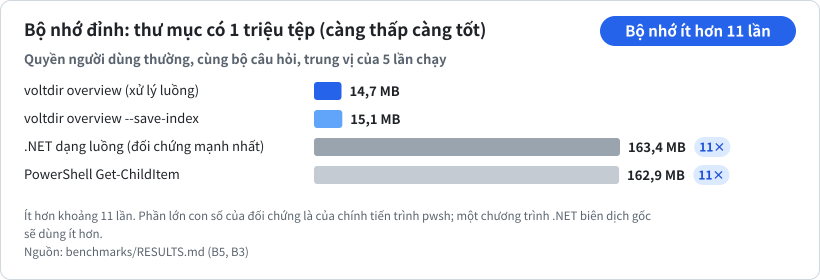
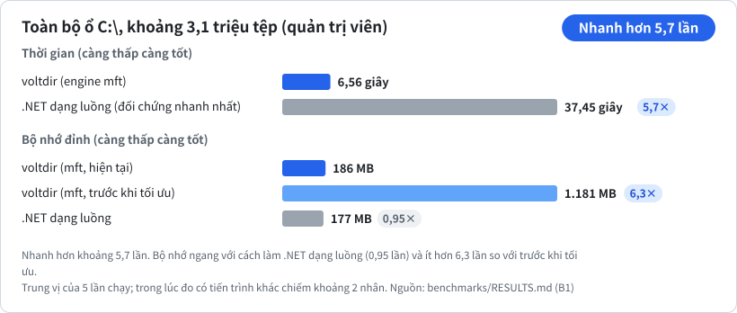
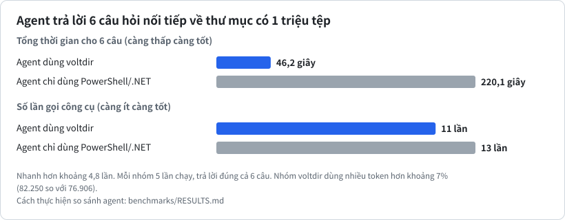
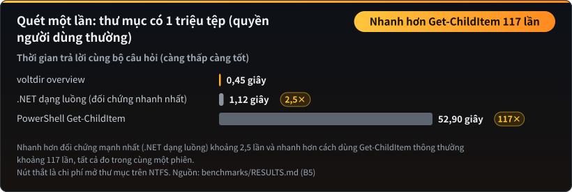
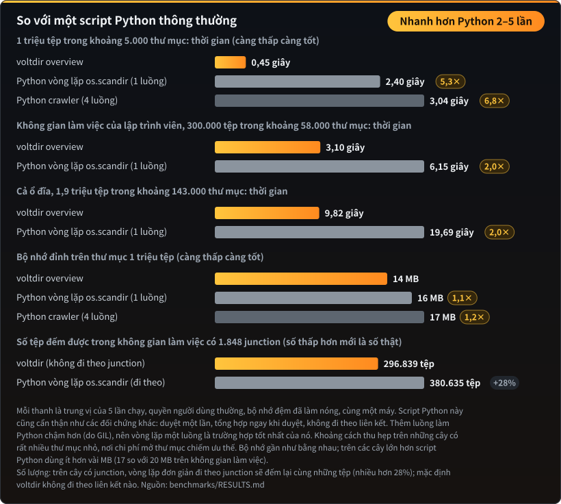

# Kết quả đo hiệu năng

← Quay lại [README](README.vi.md)

Mọi con số dưới đây đều lấy từ các bài đo có thể tái lập trong `benchmarks\`. Mỗi ô là trung vị của 5 lần chạy; lần đo nào có tiến trình nền đang dùng CPU đều được ghi chú là có nhiễu.

## Câu hỏi tiếp theo: quét một lần, hỏi nhiều lần

Thư mục có 2,6 triệu tệp, quyền người dùng thường. Mỗi câu sau câu đầu tiên mất khoảng 1 giây (trung bình của 11 lần tìm tên tệp thường gặp), còn quét lại bằng một script Python cẩn thận mất khoảng 53 giây. Câu đầu tiên không nhanh hơn quét lại. Số liệu: [`benchmarks/RESULTS.md`](benchmarks/RESULTS.md).

## Bộ nhớ: thư mục có 1 triệu tệp

voltdir tổng hợp ngay trong lúc duyệt: duyệt xong một thư mục là gộp kết quả vào thư mục cha, không giữ bản ghi cho từng tệp. Phần lớn 163 MB của phương án đối chứng là bản thân tiến trình `pwsh`; một chương trình .NET biên dịch gốc sẽ dùng ít hơn.

## Toàn bộ C:\ (quản trị viên)

## Agent trả lời các câu hỏi nối tiếp

Cùng một mô hình, cùng bộ câu hỏi, cùng quyền hạn, mỗi nhóm chạy 5 lần và đều trả lời đúng hết. Khoảng cách nằm ở các câu hỏi tiếp theo: khi đã lưu chỉ mục, mỗi câu mất khoảng 3–8 giây, còn agent đối chứng mất 7–33 giây để tính lại từ đầu. Phép so sánh ở cấp agent cần môi trường chạy agent; phương pháp được mô tả trong [`benchmarks/RESULTS.md`](benchmarks/RESULTS.md).

## Quét một lần: thư mục có 1 triệu tệp

## So với một script Python thông thường

Chỉ vài dòng Python là duyệt được một thư mục, nên dễ nghĩ rằng nó nhanh ngang nhau. Thực tế thì không. voltdir xong thư mục 1 triệu tệp trong 0,45 giây; một vòng lặp `os.scandir` thông thường mất 2,40 giây (gấp 5,3 lần), và thêm luồng còn làm nó chậm hơn do khóa trình thông dịch toàn cục (GIL) của Python. Trên không gian làm việc của lập trình viên và trên cả ổ đĩa, khoảng cách là khoảng 2 lần: khi có rất nhiều thư mục nhỏ, thời gian chủ yếu dành cho việc mở thư mục chứ không phải đọc tệp, và chi phí đó như nhau với mọi công cụ. Bộ nhớ gần như bằng nhau, vì một script Python cẩn thận cũng tổng hợp ngay khi duyệt.

| Thư mục | Số tệp | Số thư mục | voltdir | Vòng lặp Python thông thường | Python mất |
|---|---|---|---|---|---|
| Thư mục đo hiệu năng | 1.000.000 | 5.059 | 0,45 giây | 2,40 giây | gấp 5,3 lần |
| Không gian làm việc | 296.839 | 57.680 | 3,10 giây | 6,15 giây | gấp 2,0 lần |
| Cả ổ đĩa | 1.913.115 | 142.848 | 9,82 giây | 19,69 giây | gấp 2,0 lần |

**Số lượng cũng chính xác.** Trên không gian làm việc có khoảng 1.800 junction này, một vòng lặp Python `os.scandir` thông thường đếm nhiều hơn voltdir 28% số tệp (380.635 so với 296.839), vì nó đi vào mọi junction và đếm lại cùng những tệp đó. Mặc định voltdir không đi theo junction, và dữ liệu có liên kết cứng chỉ được tính một lần vào kích thước thực. Bạn có thể tự kiểm chứng: so sánh `voltdir overview <thư mục>` với `voltdir overview <thư mục> --follow-links junction`; lệnh thứ hai cho ra con số lớn hơn.
