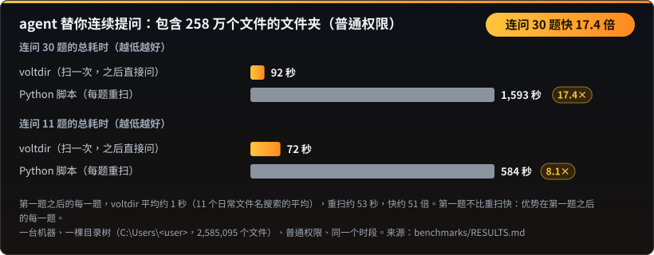
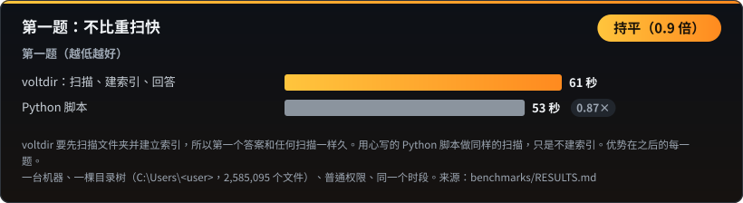
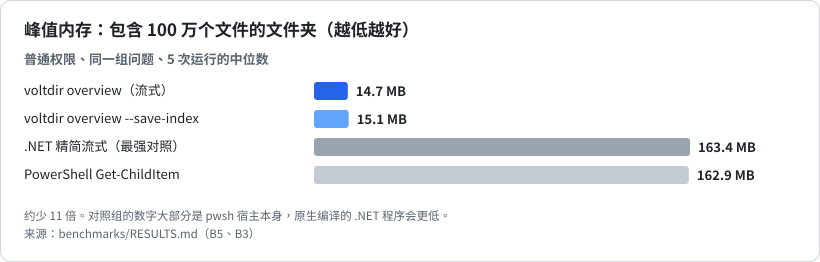
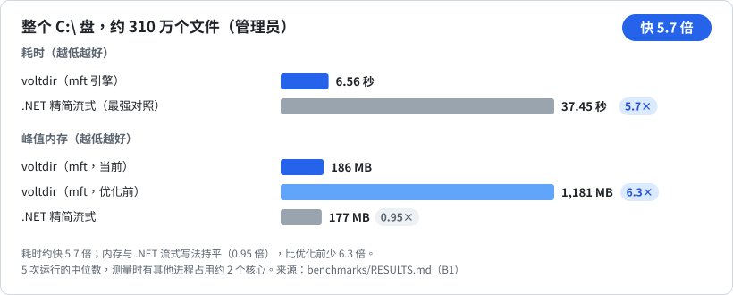
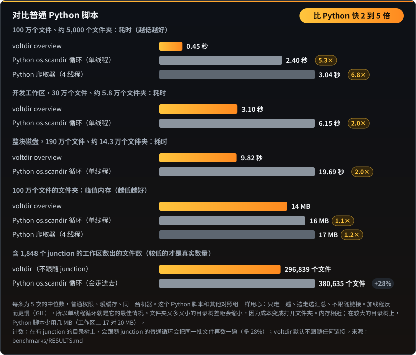

# 基准测试

← 返回 [README](README.zh-CN.md)

以下数据均来自 `benchmarks\` 中可复现的基准测试。每项跑 5 次取中位数；测量时如有后台进程占用 CPU，会标注噪声警告。

## 连续追问：扫一次，问很多次

包含 258 万个文件的文件夹，普通权限。第一题之后的每一题约 1 秒（11 个日常文件名搜索的平均），用心写的 Python 脚本每题重扫约 53 秒。第一题不比重扫快。数字：[`benchmarks/RESULTS.md`](benchmarks/RESULTS.md)。

## 内存：含 100 万个文件的文件夹

voltdir 边遍历边汇总：一个文件夹遍历完就并入上一层，不保留逐个文件的记录。对照组的 163 MB 大部分是 `pwsh` 宿主本身，原生编译的 .NET 程序会更低。

## 整个 C:\（管理员）

## agent 连续追问

同一个模型、同一组问题、同样的权限，两组各跑 5 次，全部答对。差距来自追问：保存索引后，每个追问约 3 到 8 秒；对照组每个追问要花 7 到 33 秒重新计算。agent 层面的对比需要 agent 运行环境，方法见 [`benchmarks/RESULTS.md`](benchmarks/RESULTS.md)。

## 单次扫描：含 100 万个文件的文件夹

## 对比普通 Python 脚本

几行 Python 就能遍历一个文件夹，所以很容易以为它同样快。其实不然。含 100 万个文件的文件夹，voltdir 只要 0.45 秒；普通的 `os.scandir` 循环要 2.40 秒（慢 5.3 倍），而且加上线程反而更慢，因为 Python 有全局解释器锁（GIL）。在开发工作区和整块磁盘上，差距约 2 倍：文件夹又多又小时，时间主要花在打开文件夹而不是读文件，这部分开销每个工具都一样。内存相近，因为写得仔细的 Python 脚本同样是边遍历边汇总。

| 文件夹 | 文件数 | 文件夹数 | voltdir | 普通 Python 循环 | Python 要花 |
|---|---|---|---|---|---|
| 基准文件夹 | 1,000,000 | 5,059 | 0.45 秒 | 2.40 秒 | 5.3 倍时间 |
| 开发工作区 | 296,839 | 57,680 | 3.10 秒 | 6.15 秒 | 2.0 倍时间 |
| 整块磁盘 | 1,913,115 | 142,848 | 9.82 秒 | 19.69 秒 | 2.0 倍时间 |

**计数也是对的。** 在这个包含约 1,800 个 junction 的工作区里，普通的 Python `os.scandir` 循环会多算 28% 的文件（380,635 个，voltdir 是 296,839 个），因为它会走进每个 junction，把同一批文件再算一遍。voltdir 默认不跟随 junction，硬链接的数据在实际大小上只算一次。你可以自己验证：比较 `voltdir overview <文件夹>` 和 `voltdir overview <文件夹> --follow-links junction`，后者会得到较大的那个数字。
