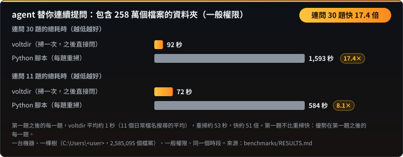
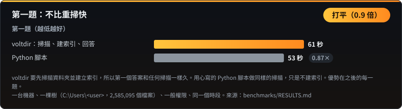
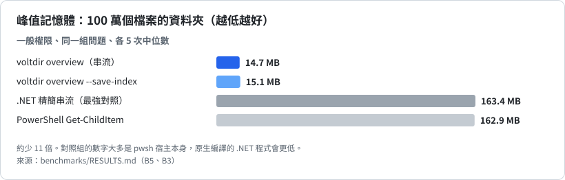
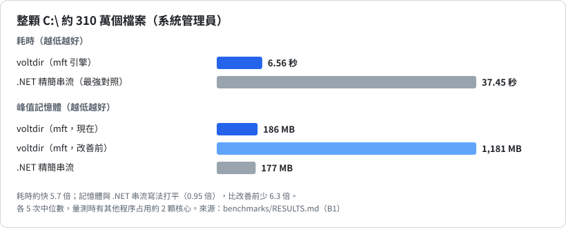
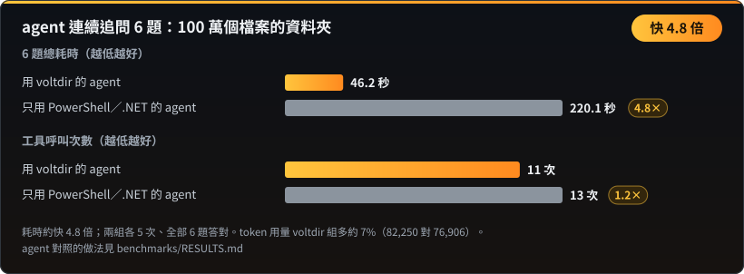
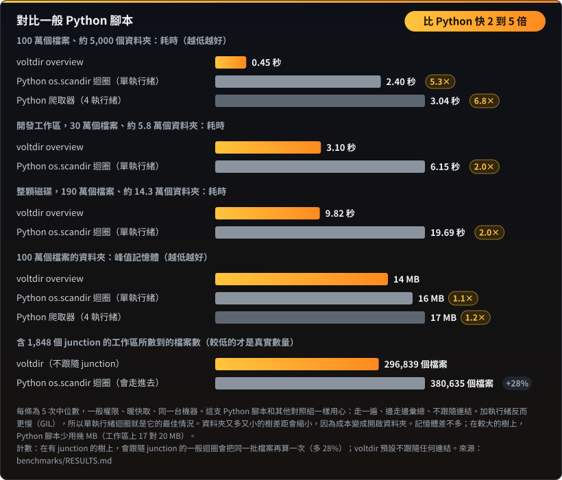

# 基準結果

← 回到 [README](README.zh-TW.md)

以下數字都來自 `benchmarks\` 裡可重現的基準。每格各跑 5 次取中位數；量測時若有背景程序占用 CPU，會標註雜訊警告。

## 連續追問：掃一次，問很多次

包含 258 萬個檔案的資料夾，一般權限。第一題之後的每一題約 1 秒（11 個日常檔名搜尋的平均），用心寫的 Python 腳本每題重掃約 53 秒。第一題不比重掃快。數字：[`benchmarks/RESULTS.md`](benchmarks/RESULTS.md)。

## 記憶體：100 萬個檔案的資料夾

voltdir 邊走邊彙總：資料夾走完就併進上一層，不保留每個檔案的紀錄。對照組的 163 MB 大多是 `pwsh` 宿主本身，原生編譯的 .NET 程式會更低。

## 整顆 C:\（系統管理員）

## agent 連續追問

同一個模型、同一組題目、同樣的權限，兩組各跑 5 次，全部答對。差距來自追問：存好索引後，每個追問約 3 到 8 秒；對照組每個追問要花 7 到 33 秒重算。agent 層級的對照需要 agent 執行環境，做法寫在 [`benchmarks/RESULTS.md`](benchmarks/RESULTS.md)。

## 單次掃描：100 萬個檔案的資料夾

## 對比一般 Python 腳本

幾行 Python 就能走完一個資料夾，所以很容易以為它做得一樣快。其實不然。100 萬個檔案的資料夾，voltdir 只要 0.45 秒；一般的 `os.scandir` 迴圈要 2.40 秒（慢 5.3 倍），而且加上執行緒反而更慢，因為 Python 有全域直譯器鎖（GIL）。在開發工作區與整顆磁碟上，差距約 2 倍：資料夾又多又小時，時間主要花在開啟資料夾而不是讀檔案，這個成本每個工具都一樣。記憶體差不多，因為寫得仔細的 Python 腳本也是邊走邊彙總。

| 資料夾 | 檔案數 | 資料夾數 | voltdir | 一般 Python 迴圈 | Python 要花 |
|---|---|---|---|---|---|
| 基準資料夾 | 1,000,000 | 5,059 | 0.45 秒 | 2.40 秒 | 5.3 倍時間 |
| 開發工作區 | 296,839 | 57,680 | 3.10 秒 | 6.15 秒 | 2.0 倍時間 |
| 整顆磁碟 | 1,913,115 | 142,848 | 9.82 秒 | 19.69 秒 | 2.0 倍時間 |

**計數也是對的。** 在這個含有約 1,800 個 junction 的工作區，一般的 Python `os.scandir` 迴圈會多算 28% 的檔案（380,635 個，voltdir 是 296,839 個），因為它會走進每個 junction，把同一批檔案再算一次。voltdir 預設不跟隨 junction，硬連結的資料在實際大小上只算一次。你可以自己驗證：比較 `voltdir overview <資料夾>` 和 `voltdir overview <資料夾> --follow-links junction`，後者會得到較大的那個數字。
