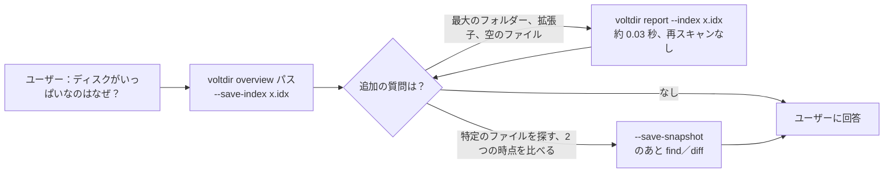
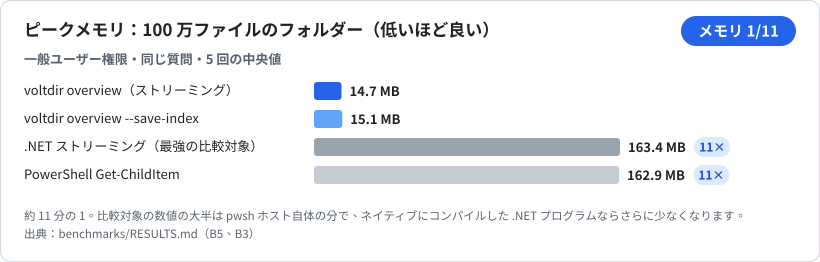
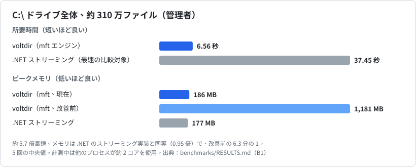
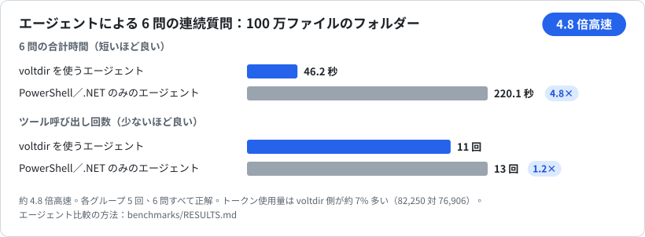
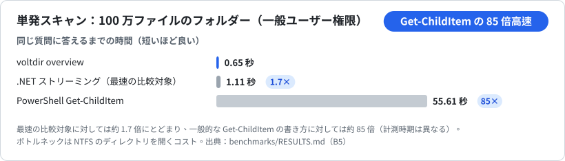

<p align="center"></p>

**表示言語：** [English](README.md) · [正體中文](README.zh-TW.md) · [简体中文](README.zh-CN.md) · [한국어](README.ko.md) · 日本語 · [Tiếng Việt](README.vi.md)

**AI エージェントのための Windows ディスク分析ツール。** 1 回の呼び出しで、ドライブを何が圧迫しているかがわかります。大きいフォルダー、容量を占めている拡張子、空のファイルの場所、ここ数日で増えたもの。読み取り専用、単一の実行ファイル、出力は形式が固定された JSON です。

| 100 万ファイルのフォルダー | `C:\` 全体（管理者） | エージェントが 6 問を続けて回答 |
|:---:|:---:|:---:|
| メモリ **約 1/11**<br>14.7 MB 対 163 MB | 所要時間 **約 5.7 倍速**<br>6.6 秒 対 37.5 秒 | 所要時間 **約 4.8 倍速**<br>46 秒 対 220 秒 |

比較対象は、よく書かれた PowerShell／.NET の複数の実装のうち最も速いものです。いずれも 5 回計測の中央値です。全数値と**まだ勝てていない点**は [`benchmarks/RESULTS.md`](benchmarks/RESULTS.md) に、手元のマシンで再現するスクリプトは [`benchmarks/`](benchmarks/README.md) にあります。

- **読み取り専用：** 読むのは名前・サイズ・日時・属性だけです。ファイルの中身は読まず、削除も移動もせず、ネットワークに接続せず、自分で権限を昇格することもありません。
- **`voltdir.exe` ひとつ**（x64、約 0.75 MB）：C ランタイムを静的リンクし、Windows 標準の DLL だけを読み込みます。別途インストールする依存関係はありません。
- **エージェント向けスキル：** [`skills/voltdir/SKILL.md`](skills/voltdir/SKILL.md)（約 4,500 文字）とビルド済みの実行ファイルを同梱。最初の一手は必ず `overview` です。
- 状態：**v1 候補**。Windows x64 のみ対応。

---

## インストール

### Claude Code プラグインとして

```text
/plugin marketplace add CubeLink-oss/voltdir
/plugin install voltdir@voltdir
```

プラグインにはスキルとビルド済みの `voltdir.exe`（[`skills/voltdir/bin/`](skills/voltdir/bin)）が含まれます。「ディスクがいっぱいなのはなぜ？」「大きいファイルを探して」「今週増えたものは？」といった質問に、エージェントが自動で使います。

### 実行ファイル単体で

[`skills/voltdir/bin/voltdir.exe`](skills/voltdir/bin) を好きなフォルダーにコピーするだけで使えます。インストールは不要です。現時点ではコード署名がないため、初回実行時に Windows SmartScreen の警告が出ることがあります。実行する前に、このソースからビルドされたものか確認できます。[同梱の実行ファイルを検証する](#同梱の実行ファイルを検証する)を参照してください。

---

## クイックスタート

```powershell
# 最初の呼び出し：合計、最大のフォルダーとファイル、拡張子、長期間未更新の大きいファイル、空のファイル、
# そのまま実行できる next コマンド
voltdir overview D:\Projects

# 同じスキャンで軽量なインデックスを保存しておけば、追加の質問で再スキャンは不要
voltdir overview D:\Projects --save-index C:\Temp\p.idx
voltdir report --index C:\Temp\p.idx --top-dirs 20 --by-ext 15

# find や diff が必要なときだけ完全なスナップショットを保存
voltdir overview D:\Projects --save-snapshot C:\Temp\p.ndjson
voltdir find --snapshot C:\Temp\p.ndjson --ext .log --min-size 100M --sort size --limit 20
voltdir diff C:\Temp\monday.ndjson C:\Temp\friday.ndjson --match-roots
```

ドライブ全体をスキャンするときは、PowerShell を**管理者として実行**してください。NTFS のマスター ファイル テーブル（MFT）を直接読む `mft` エンジンが使えるようになります。管理者でない場合は自動的に `walk` エンジンに切り替わり、一部のシステム フォルダーは読み取れません。読めなかった場所は出力の `coverage` にすべて列挙されます。

### エージェントでの使われ方



---

## ベンチマーク

以下の数値はすべて `benchmarks\` にある再現可能なベンチマークによるものです。各項目は 5 回計測の中央値で、計測中にバックグラウンドのプロセスが CPU を使っていた場合はノイズとして注記しています。

### メモリ：100 万ファイルのフォルダー



voltdir は走査しながら集計します。フォルダーを走査し終えるとその結果を親に畳み込むため、ファイルごとの記録は保持しません。比較対象の 163 MB の大半は `pwsh` ホスト自体で、ネイティブにコンパイルした .NET プログラムならもっと少なくなります。

### C:\ 全体（管理者）



### エージェントによる連続した質問への回答



同じモデル、同じ質問、同じ権限で、各グループ 5 回実行し、すべて正解しました。差がつくのは追加の質問です。インデックスを保存しておけば 1 問あたり約 3〜8 秒、比較対象のエージェントは毎回 7〜33 秒かけて計算し直します。エージェント単位の比較にはエージェントの実行環境が必要で、手順は [`benchmarks/RESULTS.md`](benchmarks/RESULTS.md) に記載しています。

### 単発スキャン：100 万ファイルのフォルダー



### まだ勝てていない点

| 項目 | 現状 |
|---|---|
| 管理者権限なしの単発スキャン | 100 万ファイルでは最速の .NET 実装より約 1.7 倍速いだけで、`C:\` 全体ではむしろ遅くなります（0.78 倍）。ボトルネックは NTFS でディレクトリを開くコストです |
| トークン使用量 | 比較対象とほぼ同じで、voltdir 側が 4〜10% 多く使いました。エージェントの呼び出しごとに約 7.3 万トークンの固定コストがあり、どんなツールでも減らせません |
| 管理者でのドライブ全体スキャンのメモリ | 186 MB。.NET のストリーミング実装（177 MB）と同程度で、優位はありません |

理由は [`benchmarks/RESULTS.md`](benchmarks/RESULTS.md) で説明しています。

---

## コマンド

| コマンド | 役割 | 出力 |
|---|---|---|
| `overview <PATH>... \| --snapshot <FILE> \| --index <FILE>` | **よくある質問に 1 回で答えます**（約 3 KB）：合計、最大のフォルダーとファイル、拡張子の分布、長期間未更新の大きいファイル、空のファイルと空のフォルダー、読めなかった場所、そのまま実行できる `next` コマンド。オプション：`--save-index`、`--save-snapshot`、`--rank physical\|logical`、`--dir-rank rollup\|direct`、`--detail concise\|full` | JSON 1 件（`voltdir.overview/1`） |
| `report <PATH>... \| --snapshot <FILE> \| --index <FILE>` | 直接の集計：`--top-files`、`--top-dirs`、`--by-ext`、`--many-files` | JSON 1 件（`voltdir.report/1`） |
| `find <PATH>... \| --snapshot <FILE>` | 名前（ワイルドカードまたは `--name-regex`）、パス、種類、拡張子、サイズ、日付、空かどうかで検索 | JSON 1 件（`voltdir.find/1`） |
| `diff <A> <B>` | 2 つのスナップショットを比較：増えたもの、減ったもの、追加、削除。パスが異なるスナップショット同士なら `--match-roots`（または `--a-root`／`--b-root`）を付けます | JSON 1 件（`voltdir.diff/1`） |
| `scan <PATH>... --out <FILE>` | **スナップショット**だけを出力します。数百 MB になることがあるため `--out` は必須です。標準出力に出すときは `--out -` と明示します | NDJSON（`voltdir.snapshot/1`） |
| `info` | 環境と機能：バージョン、昇格の有無、使えるエンジン、ボリューム | JSON 1 件 |

主なオプション：`--out <FILE|->`、`--engine auto|mft|walk`、`--threads <N>`、`--exclude <GLOB>`、`--follow-links mount|symlink|junction`、`--hardlinks dedupe|none`、`--timeout-sec <N>`、`-q`。構文の詳細は `voltdir --help` または `voltdir help <コマンド>` で確認できます。

## 2 つのエンジン

| | `walk` | `mft` |
|---|---|---|
| 管理者権限 | 不要 | **必要**（ボリュームの MFT を読むため） |
| 対象 | 任意のフォルダー、任意のファイル システム | ローカル NTFS ドライブの**ルート**のみ（`C:\` など） |
| `C:\` 全体（約 310 万ファイル） | 約 54 秒 | **約 6.6 秒、ピーク 186 MB** |
| 見える範囲 | 権限に左右され、`$MFT` などの予約エントリは見えません | 予約エントリ（`reserved: true` と表示）と `System Volume Information` の中身も見えます |

`--engine auto`（既定）は条件がそろえば `mft` を使い、そうでなければ `walk` に切り替えて理由を stderr に出します。`--engine mft` は厳格モードで、使えない場合は終了コード 3 で終わります。

## 終了コード

| コード | 意味 |
|---|---|
| 0 | 完全に成功 |
| 1 | 使い方の誤り。使えないスナップショットやインデックス、ルートが重ならないスナップショット同士を `--match-roots` なしで `diff` した場合を含みます |
| 2 | 結果は有効ですが、**一部のフォルダーを読めませんでした**（多くはアクセス拒否）。場所は `coverage` に列挙されます。**完全な結果として扱わないでください** |
| 3 | 指定したエンジンが使えません（管理者でないのに `--engine mft` を指定した、NTFS 以外のボリュームなど） |
| 4 | 出力ファイルの書き込みに失敗しました（書きかけのファイルは残しません） |
| 5 | タイムアウトまたはキャンセル（スキャン済みの部分は出力します） |

## 出力形式のポイント

- パスは `\\?\` プレフィックスのない Win32 形式です。対になっていない UTF-16 サロゲートは `\uXXXX` にエスケープするので失われません。制御文字と双方向テキスト用の文字は常にエスケープし、細工したファイル名でエージェントにプロンプト インジェクションを仕掛けられないようにしています。
- 日時は UTC の RFC 3339、サイズはバイト単位の整数です。`size_logical` はファイルの終端位置、`size_physical` はディスク上で実際に割り当てられた容量です。
- 出力順は固定です。同じ入力と同じエンジンなら、出力はバイト単位で一致します。
- **ハードリンク**は、実際のサイズでは 1 回だけ、論理サイズでは名前ごとに数えます。

## ビルドとテスト

Rust 1.94 以降（MSVC ツールチェーン）が必要です。

```powershell
cargo build --release          # target\release\voltdir.exe を生成
.\scripts\ci.ps1               # フォーマット、clippy、全テスト、ライセンス確認、ベンチマーク スクリプトの自己テスト、スキルの確認
```

ベンチマークの再現手順は [`benchmarks/README.md`](benchmarks/README.md) を参照してください。

## 同梱の実行ファイルを検証する

[`skills/voltdir/bin/`](skills/voltdir/bin) の `voltdir.exe` は別の場所から持ってきたものではなく、このリポジトリのソースから `cargo build --release` でビルドしたものです。SHA-256 ハッシュは隣の `voltdir.exe.sha256` に記録しています。ビルドは決定的です。リンカーに `/Brepro` を指定しているため、実行ファイルにはタイムスタンプもビルド環境のパスも含まれません。同じコミットと同じツールチェーンなら、同じバイト列になります。

公開している実行ファイルは **Rust 1.94.0**（`x86_64-pc-windows-msvc`）でビルドしています。自分で確認する手順：

```powershell
git clone https://github.com/CubeLink-oss/voltdir
cd voltdir
rustup toolchain install 1.94.0
cargo +1.94.0 build --release
(Get-FileHash target\release\voltdir.exe -Algorithm SHA256).Hash
Get-Content skills\voltdir\bin\voltdir.exe.sha256
```

2 つのハッシュは一致するはずです（前者は大文字で表示されます）。一致しない場合は、同じコミットであること、`rustc +1.94.0 -V` が 1.94.0 を表示することを確認してください。MSVC リンカーのバージョンが違ってもバイト列が変わることがあります。自分でビルドしていないファイルを実行したくない場合は、自分の `target\release\voltdir.exe` を使ってください。スキルは `PATH` 上の `voltdir` も使えます。

セキュリティ スキャナーの中には、実行ファイルを同梱したスキルを一律に警告するものがあります。これは想定どおりで、上の手順がご自身で確かめるための方法です。

## リポジトリの構成

| 場所 | 内容 |
|---|---|
| [`skills/voltdir/`](skills/voltdir) | エージェント向けスキル：[`SKILL.md`](skills/voltdir/SKILL.md)、詳細リファレンス [`reference.md`](skills/voltdir/reference.md)、ビルド済みの `bin/voltdir.exe` |
| [`.claude-plugin/`](.claude-plugin) | Claude Code のプラグインとマーケットプレイスの設定 |
| [`benchmarks/`](benchmarks/README.md) | 再現可能なベンチマーク スクリプトと[結果の概要](benchmarks/RESULTS.md) |
| `src/`、`tests/` | ソースコードとテスト |
| `scripts/` | CI、ライセンス確認、テストデータの生成 |

## ライセンス

[Apache License 2.0](LICENSE)。著作権者は [`NOTICE`](NOTICE) に記載しています。
