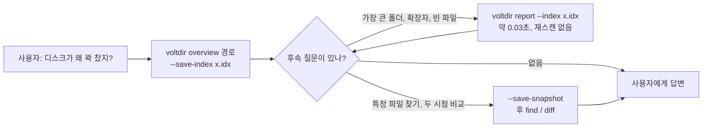
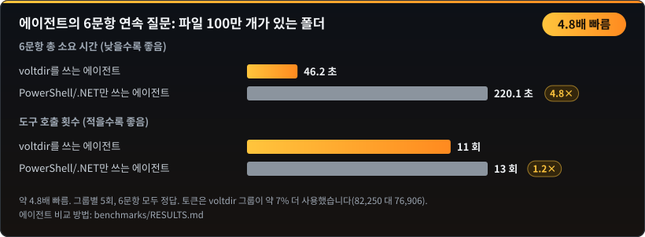
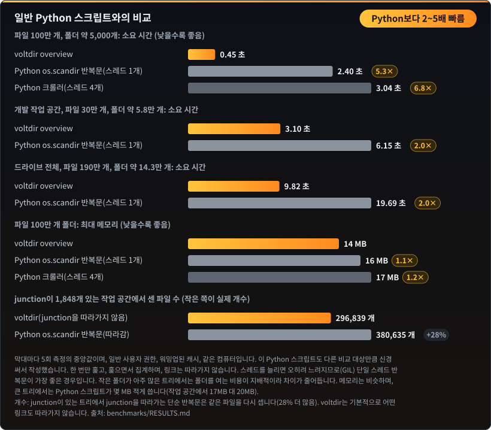

<p align="center"></p>

**다른 언어로 읽기:** [English](README.md) · [正體中文](README.zh-TW.md) · [简体中文](README.zh-CN.md) · 한국어 · [日本語](README.ja.md) · [Tiếng Việt](README.vi.md)

**AI 에이전트를 위한 Windows 디스크 분석 도구.** 한 번의 호출로 드라이브를 무엇이 채우고 있는지 알 수 있습니다. 가장 큰 폴더, 공간을 가장 많이 차지하는 확장자, 빈 파일의 위치, 최근 며칠 사이에 늘어난 것까지. 읽기 전용, 실행 파일 하나, 형식이 고정된 JSON 출력.

| 파일 100만 개가 든 폴더 | `C:\` 전체 (관리자) | 에이전트가 연속 질문 6개에 답변 |
|:---:|:---:|:---:|
| 메모리 **약 1/11**<br>14 MB 대 163 MB | 소요 시간 **약 5.7배 빠름**<br>6.6초 대 37.5초 | 소요 시간 **약 4.8배 빠름**<br>46초 대 220초 |

비교 대상은 잘 작성된 PowerShell/.NET 구현 여러 개 중 가장 빠른 것이며, 모두 5회 측정의 중앙값입니다. 전체 수치와 **아직 앞서지 못한 부분**은 [`benchmarks/RESULTS.md`](benchmarks/RESULTS.md)에 있고, [`benchmarks/`](benchmarks/README.md)의 스크립트로 직접 재현할 수 있습니다.

- **읽기 전용:** 이름, 크기, 시간, 속성만 읽습니다. 파일 내용을 읽지 않고, 삭제하거나 옮기지 않으며, 네트워크에 연결하지 않고, 스스로 권한을 높이지도 않습니다.
- **`voltdir.exe` 하나** (x64, 약 0.75 MB): C 런타임을 정적으로 링크하고 Windows 기본 DLL만 가져옵니다. 따로 설치할 의존성이 없습니다.
- **에이전트용 스킬:** [`skills/voltdir/SKILL.md`](skills/voltdir/SKILL.md) (약 4,500자)와 빌드된 실행 파일이 함께 들어 있으며, 첫 단계는 항상 `overview`입니다.
- 상태: **v1 후보**, Windows x64 전용.

## 사용 사례: 한 번 스캔하고, 몇 번이든 질문하기

에이전트에게 "디스크가 왜 꽉 찼지?"를 한 번만 묻고 끝내는 경우는 드뭅니다. 이어지는 질문은 언제나 같은 폴더에 대한 것입니다. 어떤 프로젝트가 가장 큰지, 어떤 확장자가 가장 많은지, 오래되고 큰 파일을 정리해도 되는지, 지난주 이후 무엇이 바뀌었는지. 전용 도구가 없는 에이전트는 질문마다 폴더를 처음부터 다시 훑거나, 같은 일을 하는 일회용 스크립트를 짭니다. 게다가 그 스크립트는 보기보다 느립니다. 일반적인 Python `os.scandir` 반복문은 같은 폴더를 훑는 데 voltdir의 2~5배 시간이 걸립니다(측정은 아래 참고).

voltdir는 바로 이런 사용 방식에 맞춰 만들었습니다.

1. **한 번 스캔합니다.** 한 번의 호출로 폴더를 훑고, 자주 묻는 질문에 답하고, 작은 인덱스를 저장합니다(파일 30만 개 규모의 작업 공간에서 약 2 MB).
2. **몇 번이고 다시 묻습니다.** 후속 질문은 디스크 대신 인덱스를 읽으므로 한 번에 약 0.05초입니다.
3. **더 필요하면 스냅숏을 남깁니다.** 스냅숏(같은 작업 공간에서 약 157 MB)은 `find`에도 답하고, 스냅숏 두 개가 있으면 `diff`로 "무엇이 바뀌었는지"에 답합니다. 아주 큰 드라이브에서는 스냅숏을 저장하는 데 인덱스만 저장할 때보다 시간이 더 걸립니다.

`overview` 응답 끝에는 `next` 필드가 있어, 이어서 실행할 만한 명령을 그대로 보여 줍니다. 에이전트가 옵션을 추측할 필요가 없습니다.



예시: 파일이 약 30만 개인 개발 작업 공간.

```powershell
# 월요일: 한 번의 스캔으로 자주 묻는 질문에 답하고, 스냅숏과 작은 인덱스를 남깁니다(약 3초)
voltdir overview D:\Workspace --save-snapshot C:\Temp\ws-mon.ndjson

# 후속 질문은 디스크가 아니라 작은 인덱스를 읽습니다(각 약 0.05초)
voltdir report --snapshot C:\Temp\ws-mon.ndjson --top-dirs 20 --dir-depth 3   # 공간이 어디에 쓰였나?
voltdir report --snapshot C:\Temp\ws-mon.ndjson --by-ext 15                    # 어떤 확장자가 많나?
voltdir report --snapshot C:\Temp\ws-mon.ndjson --many-files 15                # 작은 파일이 몰린 곳은?

# 검색은 스냅숏을 읽습니다(약 1초)
voltdir find --snapshot C:\Temp\ws-mon.ndjson --name package.json --sort size --limit 20

# 금요일: 다시 스캔하고 무엇이 바뀌었는지 묻습니다(약 3초)
voltdir scan D:\Workspace --out C:\Temp\ws-fri.ndjson
voltdir diff C:\Temp\ws-mon.ndjson C:\Temp\ws-fri.ndjson --top 30
```

**개수도 정확합니다.** junction이 약 1,800개 있는 이 작업 공간에서 일반적인 Python `os.scandir` 반복문은 voltdir보다 파일을 28% 더 많이 셌습니다(380,635개, voltdir는 296,839개). 모든 junction 안으로 들어가 같은 파일을 다시 세기 때문입니다. voltdir는 기본적으로 junction을 따라가지 않고, 하드 링크된 데이터는 실제 크기에 한 번만 더합니다. 직접 확인하려면 `voltdir overview <폴더>`와 `voltdir overview <폴더> --follow-links junction`을 비교해 보세요. 뒤쪽이 더 큰 숫자를 냅니다.

---

## 설치

### Claude Code 플러그인으로

```text
/plugin marketplace add CubeLink-oss/voltdir
/plugin install voltdir@voltdir
```

플러그인에는 스킬과 빌드된 `voltdir.exe`([`skills/voltdir/bin/`](skills/voltdir/bin))가 들어 있습니다. "디스크가 왜 꽉 찼지?", "큰 파일 찾아 줘", "이번 주에 뭐가 늘었어?" 같은 질문에 에이전트가 자동으로 사용합니다.

### 실행 파일만 따로

[`skills/voltdir/bin/voltdir.exe`](skills/voltdir/bin)를 아무 폴더에나 복사하면 바로 쓸 수 있으며, 설치는 필요 없습니다. 아직 코드 서명이 없어서 처음 실행할 때 Windows SmartScreen 경고가 나타날 수 있습니다. 실행하기 전에 이 소스로 빌드한 파일인지 확인할 수 있습니다. [포함된 실행 파일 검증하기](#포함된-실행-파일-검증하기)를 참고하세요.

---

## 빠른 시작

```powershell
# 첫 호출: 합계, 가장 큰 폴더와 파일, 확장자, 오래 수정되지 않은 큰 파일, 빈 파일,
# 그리고 바로 실행할 수 있는 next 명령
voltdir overview D:\Projects

# 같은 스캔에서 가벼운 인덱스를 저장해 두면 후속 질문에 다시 스캔할 필요가 없습니다
voltdir overview D:\Projects --save-index C:\Temp\p.idx
voltdir report --index C:\Temp\p.idx --top-dirs 20 --by-ext 15

# find나 diff가 필요할 때만 전체 스냅숏을 저장합니다
voltdir overview D:\Projects --save-snapshot C:\Temp\p.ndjson
voltdir find --snapshot C:\Temp\p.ndjson --ext .log --min-size 100M --sort size --limit 20
voltdir diff C:\Temp\monday.ndjson C:\Temp\friday.ndjson --match-roots
```

드라이브 전체를 스캔할 때는 PowerShell을 **관리자 권한으로 실행**하세요. 그래야 NTFS 마스터 파일 테이블(MFT)을 직접 읽는 `mft` 엔진을 쓸 수 있습니다. 관리자가 아니면 자동으로 `walk` 엔진으로 바뀌고 일부 시스템 폴더는 읽지 못하며, 읽지 못한 위치는 출력의 `coverage`에 모두 나열됩니다.

---

## 벤치마크

아래 수치는 모두 `benchmarks\`의 재현 가능한 벤치마크에서 나온 것입니다. 각 항목은 5회 측정의 중앙값이며, 측정 중 백그라운드 프로세스가 CPU를 쓰고 있었다면 노이즈로 표시했습니다.

### 메모리: 파일 100만 개가 든 폴더


voltdir는 탐색하면서 바로 집계합니다. 폴더 하나를 다 돌면 그 결과를 상위 폴더에 합치므로 파일별 기록을 남기지 않습니다. 비교 대상의 163 MB는 대부분 `pwsh` 호스트 자체이며, 네이티브로 컴파일한 .NET 프로그램이라면 더 적을 것입니다.

### C:\ 전체 (관리자)


### 에이전트의 연속 질문 답변



같은 모델, 같은 질문, 같은 권한으로 그룹마다 5회씩 실행했고 모두 정답이었습니다. 차이는 후속 질문에서 납니다. 인덱스를 저장해 두면 질문 하나에 약 3~8초, 비교 대상 에이전트는 매번 7~33초를 들여 다시 계산합니다. 에이전트 단위 비교에는 에이전트 실행 환경이 필요하며, 방법은 [`benchmarks/RESULTS.md`](benchmarks/RESULTS.md)에 있습니다.

### 단일 스캔: 파일 100만 개가 든 폴더


### 일반 Python 스크립트와의 비교



Python 몇 줄이면 폴더를 훑을 수 있어서 같은 속도일 거라고 생각하기 쉽습니다. 실제로는 그렇지 않습니다. 파일 100만 개가 든 폴더를 voltdir는 0.45초에 끝내지만, 일반적인 `os.scandir` 반복문은 2.40초(5.3배 시간)가 걸리고, 스레드를 늘리면 Python의 전역 인터프리터 락(GIL) 때문에 오히려 더 느려집니다. 개발 작업 공간과 드라이브 전체에서는 차이가 약 2배입니다. 작은 폴더가 아주 많으면 시간 대부분이 파일을 읽는 일이 아니라 폴더를 여는 데 쓰이고, 그 비용은 어떤 도구든 같기 때문입니다. 꼼꼼하게 작성한 Python 스크립트도 훑으면서 집계하므로 메모리는 비슷합니다.

| 폴더 | 파일 수 | 폴더 수 | voltdir | 일반 Python 반복문 | Python 소요 시간 |
|---|---|---|---|---|---|
| 벤치마크 폴더 | 1,000,000 | 5,059 | 0.45초 | 2.40초 | 5.3배 |
| 개발 작업 공간 | 296,839 | 57,680 | 3.10초 | 6.15초 | 2.0배 |
| 드라이브 전체 | 1,913,115 | 142,848 | 9.82초 | 19.69초 | 2.0배 |

### 아직 앞서지 못한 부분

| 항목 | 현황 |
|---|---|
| 관리자 권한 없는 단일 스캔 | 파일 100만 개에서는 가장 빠른 .NET 구현보다 약 2.5배 빠르지만, `C:\` 전체에서는 오히려 느립니다(0.78배). 병목은 NTFS에서 디렉터리를 여는 비용입니다 |
| 토큰 사용량 | 비교 대상과 비슷하며 voltdir 쪽이 4~10% 더 썼습니다. 에이전트 호출마다 약 7.3만 토큰의 고정 비용이 있어 어떤 도구로도 줄일 수 없습니다 |
| 관리자 권한으로 드라이브 전체를 스캔할 때의 메모리 | 186 MB로 .NET 스트리밍 구현(177 MB)과 비슷하며, 앞서지는 못합니다 |

이유는 [`benchmarks/RESULTS.md`](benchmarks/RESULTS.md)에 설명되어 있습니다.

## 잘 되는 것과 주의할 것

**잘 되는 것**

- **믿을 수 있는 개수.** junction과 하드 링크를 처리하므로 합계가 실제와 맞습니다(위 참고).
- **조용히 빠뜨리지 않습니다.** 읽지 못한 폴더가 있으면 종료 코드가 2이고 `coverage`에 모두 나열됩니다.
- **후속 질문이 저렴합니다.** 인덱스가 있으면 질문 하나에 약 0.05초입니다.
- **출력이 안정적입니다.** 같은 입력과 같은 엔진이면 JSON이 바이트 단위로 같습니다.

**독립 평가에서 발견되어 0.0.2에서 수정했습니다.** 에이전트가 실제로 쓰는 방식으로 voltdir를 테스트했고, 버그로 확인된 것은 모두 고쳤습니다.

- 슬래시로 쓴 패턴(`--exclude "*/node_modules/*"`, `--path "*/src/*"`)은 이전에는 아무것도 일치하지 않았고, 그것도 조용히 그랬습니다. 명령은 성공했지만 아무것도 제외되지 않았습니다. 이제 모든 패턴에서 `/`와 `\`는 같은 뜻입니다.
- 어떤 경로와도 일치하지 않는 `--exclude` 패턴은 이제 stderr에 경고를 출력합니다. 오타가 눈에 띄지 않고 지나가는 일은 없습니다.
- `--json`은 모든 명령에서 받아들입니다(아무 영향도 없으며 출력은 항상 JSON입니다). `--follow-links none`도 받아들입니다(그것이 기본값입니다).
- `--help`에 드라이브 전체 스캔의 종료 코드 2가 정상이라는 점과 `mft` 엔진의 요구 사항을 적었습니다.

**알아 둘 것**(설계에 따른 동작이며 버그가 아닙니다)

| 동작 | 이유 | 대처 |
|---|---|---|
| `find --snapshot ... --exclude`는 오류가 남 | 스캔 옵션은 스캔할 때만 적용되고 스냅숏을 읽을 때는 적용되지 않습니다 | 스캔할 때 제외(`scan --exclude`)하거나 `--path`로 거르기 |
| 드라이브 전체 스캔의 종료 코드는 2 | 휴지통 같은 시스템 폴더는 읽을 수 없습니다. 결과는 유효하며 `coverage`에 나옵니다 | 스크립트에서 2를 "경고와 함께 완료"로 처리하고 실패로 보지 않기 |
| `find --limit`은 경로 순서로 앞쪽을 남김(기본 100) | 따로 지정하지 않으면 결과는 경로순으로 정렬됩니다 | `--sort size`를 쓰고 `matched_total`과 목록 개수를 비교 |
| 속도 우위는 트리의 모양에 따라 다름 | 파일 100만 개 폴더에서는 Python 반복문의 약 5배, 개발 작업 공간이나 드라이브 전체에서는 약 2배(위 참고) | 자기 폴더에서 벤치마크를 실행해 보기 |

---

## 명령

| 명령 | 용도 | 출력 |
|---|---|---|
| `overview <PATH>... \| --snapshot <FILE> \| --index <FILE>` | **자주 묻는 질문에 한 번에 답합니다**(약 3 KB): 합계, 가장 큰 폴더와 파일, 확장자 분포, 오래 수정되지 않은 큰 파일, 빈 파일과 빈 폴더, 읽지 못한 위치, 바로 실행할 수 있는 `next` 명령. 옵션: `--save-index`, `--save-snapshot`, `--rank physical\|logical`, `--dir-rank rollup\|direct`, `--detail concise\|full` | JSON 문서 1개 (`voltdir.overview/1`) |
| `report <PATH>... \| --snapshot <FILE> \| --index <FILE>` | 직접 집계: `--top-files`, `--top-dirs`, `--by-ext`, `--many-files` | JSON 문서 1개 (`voltdir.report/1`) |
| `find <PATH>... \| --snapshot <FILE>` | 이름(와일드카드 또는 `--name-regex`), 경로, 종류, 확장자, 크기, 날짜, 비어 있는지 여부로 검색 | JSON 문서 1개 (`voltdir.find/1`) |
| `diff <A> <B>` | 두 스냅숏 비교: 커진 것, 줄어든 것, 추가된 것, 사라진 것. 경로가 다른 스냅숏끼리는 `--match-roots`(또는 `--a-root` / `--b-root`)를 붙입니다 | JSON 문서 1개 (`voltdir.diff/1`) |
| `scan <PATH>... --out <FILE>` | **스냅숏**만 출력합니다. 수백 MB가 될 수 있어 `--out`은 필수이며, 표준 출력으로 내보내려면 `--out -`라고 명시합니다 | NDJSON (`voltdir.snapshot/1`) |
| `info` | 환경과 기능: 버전, 권한 상승 여부, 사용 가능한 엔진, 볼륨 | JSON 문서 1개 |

자주 쓰는 옵션: `--out <FILE|->`, `--engine auto|mft|walk`, `--threads <N>`, `--exclude <GLOB>`, `--follow-links mount|symlink|junction`, `--hardlinks dedupe|none`, `--timeout-sec <N>`, `-q`. 전체 문법은 `voltdir --help` 또는 `voltdir help <명령>`으로 확인하세요.

## 두 가지 엔진

| | `walk` | `mft` |
|---|---|---|
| 관리자 권한 | 필요 없음 | **필요**(볼륨의 MFT를 읽음) |
| 범위 | 모든 폴더, 모든 파일 시스템 | 로컬 NTFS 드라이브의 **루트**만(예: `C:\`) |
| `C:\` 전체(파일 약 310만 개) | 약 54초 | **약 6.6초, 최대 186 MB** |
| 보이는 범위 | 권한의 제약을 받으며 `$MFT` 같은 예약 항목은 보이지 않음 | 예약 항목(`reserved: true`로 표시)과 `System Volume Information`의 내용까지 보임 |

`--engine auto`(기본값)는 조건이 맞으면 `mft`를 쓰고, 그렇지 않으면 `walk`로 바꾸면서 이유를 stderr에 알립니다. `--engine mft`는 엄격 모드로, 쓸 수 없으면 종료 코드 3으로 끝납니다.

## 종료 코드

| 코드 | 의미 |
|---|---|
| 0 | 완전히 성공 |
| 1 | 사용법 오류. 쓸 수 없는 스냅숏이나 인덱스, 루트가 겹치지 않는 두 스냅숏을 `--match-roots` 없이 `diff`한 경우를 포함합니다 |
| 2 | 결과는 유효하지만 **일부 폴더를 읽지 못했습니다**(대개 액세스 거부). 위치는 `coverage`에 나열되며, **완전한 결과로 취급하면 안 됩니다** |
| 3 | 지정한 엔진을 쓸 수 없습니다(관리자가 아닌데 `--engine mft`를 지정했거나 NTFS가 아닌 볼륨 등) |
| 4 | 출력 파일 쓰기에 실패했습니다(쓰다 만 파일은 남기지 않습니다) |
| 5 | 시간 초과 또는 취소(스캔한 부분까지는 출력합니다) |

## 출력 형식 요점

- 경로는 `\\?\` 접두사가 없는 Win32 형식입니다. 짝이 맞지 않는 UTF-16 서로게이트는 `\uXXXX`로 이스케이프하므로 손실되지 않습니다. 제어 문자와 양방향 텍스트 문자는 항상 이스케이프해서, 조작된 파일 이름으로 에이전트에 프롬프트 인젝션을 시도할 수 없게 합니다.
- 시간은 UTC 기준 RFC 3339, 크기는 바이트 단위 정수입니다. `size_logical`은 파일 끝 위치, `size_physical`은 디스크에 실제로 할당된 공간입니다.
- 출력 순서는 고정입니다. 같은 입력과 같은 엔진이면 출력이 바이트 단위로 같습니다.
- **하드 링크**는 실제 크기에서는 한 번만, 논리 크기에서는 이름마다 셉니다.

## 빌드와 테스트

Rust 1.94 이상(MSVC 툴체인)이 필요합니다.

```powershell
cargo build --release          # target\release\voltdir.exe 생성
.\scripts\ci.ps1               # 포맷, clippy, 전체 테스트, 라이선스 확인, 벤치마크 스크립트 자체 테스트, 스킬 확인
```

벤치마크 재현 방법은 [`benchmarks/README.md`](benchmarks/README.md)를 참고하세요.

## 포함된 실행 파일 검증하기

[`skills/voltdir/bin/`](skills/voltdir/bin)의 `voltdir.exe`는 다른 곳에서 가져온 파일이 아니라, 이 저장소의 소스에서 `cargo build --release`로 빌드한 것입니다. SHA-256 해시는 바로 옆의 `voltdir.exe.sha256`에 기록되어 있습니다. 빌드는 결정적입니다. 링커에 `/Brepro`를 지정하므로 실행 파일에는 타임스탬프도, 빌드한 컴퓨터의 경로도 들어가지 않습니다. 같은 커밋과 같은 툴체인이면 같은 바이트가 나옵니다.

공개된 실행 파일은 **Rust 1.94.0**(`x86_64-pc-windows-msvc`)으로 빌드했습니다. 직접 확인하는 방법:

```powershell
git clone https://github.com/CubeLink-oss/voltdir
cd voltdir
rustup toolchain install 1.94.0
cargo +1.94.0 build --release
(Get-FileHash target\release\voltdir.exe -Algorithm SHA256).Hash
Get-Content skills\voltdir\bin\voltdir.exe.sha256
```

두 해시가 같아야 합니다(앞의 것은 대문자로 표시됩니다). 다르다면 같은 커밋인지, `rustc +1.94.0 -V`가 1.94.0을 표시하는지 확인하세요. MSVC 링커 버전이 달라도 바이트가 바뀔 수 있습니다. 직접 빌드하지 않은 파일을 실행하고 싶지 않다면 직접 만든 `target\release\voltdir.exe`를 쓰면 됩니다. 스킬은 `PATH`에 있는 `voltdir`도 사용할 수 있습니다.

일부 보안 스캐너는 실행 파일이 들어 있는 스킬이면 일괄적으로 경고합니다. 이는 예상된 일이며, 위의 절차가 직접 확인하는 방법입니다.

## 저장소 구성

| 위치 | 내용 |
|---|---|
| [`skills/voltdir/`](skills/voltdir) | 에이전트용 스킬: [`SKILL.md`](skills/voltdir/SKILL.md), 전체 참고 문서 [`reference.md`](skills/voltdir/reference.md), 빌드된 `bin/voltdir.exe` |
| [`.claude-plugin/`](.claude-plugin) | Claude Code 플러그인과 마켓플레이스 설정 |
| [`benchmarks/`](benchmarks/README.md) | 재현 가능한 벤치마크 스크립트와 [결과 요약](benchmarks/RESULTS.md) |
| `src/`, `tests/` | 소스 코드와 테스트 |
| `scripts/` | CI, 라이선스 확인, 테스트 데이터 생성기 |

## 개인정보 보호

voltdir는 전적으로 사용자의 컴퓨터에서 실행됩니다. 이름, 크기, 시간, 속성만 읽으며(파일 내용은 읽지 않음), 네트워크 연결을 열지 않고, 아무것도 수집하지 않습니다. `--out`, `--save-index`, `--save-snapshot`으로 지정한 파일만 씁니다. 이 파일에는 파일 경로가 들어 있으므로 민감한 정보로 다루세요. AI 에이전트가 voltdir를 실행하면 에이전트가 출력을 읽게 되고, 그 내용은 에이전트와의 대화의 일부가 됩니다. 함께 제공되는 skill은 사용자가 직접 지정한 폴더가 아닌 한, 드라이브 전체나 개인 폴더, 사적으로 보이는 폴더를 스캔하기 전에 에이전트가 먼저 확인하도록 요청합니다. 전체 내용은 [`PRIVACY.md`](PRIVACY.md)(영어)에 있습니다. 질문과 버그 신고는 [GitHub Issues](https://github.com/CubeLink-oss/voltdir/issues)로 보내 주세요.

## 라이선스

[Apache License 2.0](LICENSE). 저작권자는 [`NOTICE`](NOTICE)에 있습니다.
