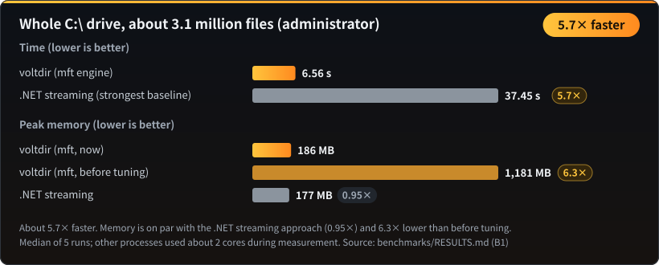
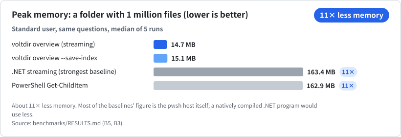
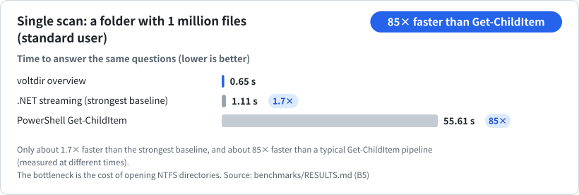
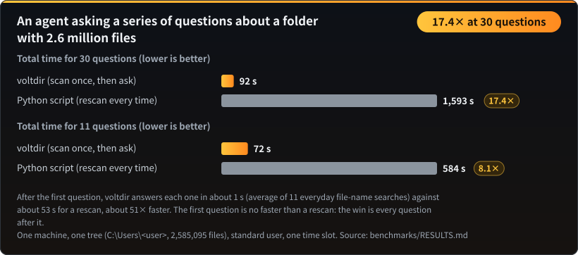

<p align="center"></p>

**Read in:** English · [正體中文](README.zh-TW.md) · [简体中文](README.zh-CN.md) · [한국어](README.ko.md) · [日本語](README.ja.md) · [Tiếng Việt](README.vi.md)

**Scan once. Then ask as many questions as you like, about a second each.**

**Windows disk analysis built for AI agents.** One call tells you what is filling a drive: the largest folders, which file types take the most space, where the empty files are, and what changed since last week. Read-only, a single executable, and stable JSON output.

| All of `C:\` (administrator) | Memory, 1 million files | One scan, 1 million files | An agent asking a series of questions |
|:---:|:---:|:---:|:---:|
| **5.7× faster**<br>6.6 s vs 37.5 s | **11× less**<br>14 MB vs 163 MB | **up to 117× faster**<br>than Get-ChildItem; 2.5× faster than the best .NET code | **17.4× faster**<br>30 questions in a row, about 1 s each |

> **The first question costs as much as any scan.** voltdir scans the folder and builds the index, and a careful Python script is no slower at that (0.9× on 2.6 million files). The win is every question after it. Where voltdir does not win yet is listed further down.

**All of `C:\` (administrator): 5.7× faster, 6.6 s against 37.5 s.**



**Memory on a folder with 1 million files: about 11× less.**



**One scan of a folder with 1 million files: up to 117× faster than a typical Get-ChildItem script, and 2.5× faster than the strongest .NET code.**



**An agent working through a series of questions for you: 17.4× faster over 30 questions, about 1 s each.**



Measured on real folders against well-written baselines. Every number, **including where voltdir does not win yet**, is in [`benchmarks/RESULTS.md`](benchmarks/RESULTS.md), all the charts are on the [benchmark page](BENCHMARKS.md), and the scripts in [`benchmarks/`](benchmarks/README.md) reproduce them on your own machine.

- **Read-only.** voltdir reads names, sizes, timestamps and attributes. It never reads file contents, never deletes or moves anything, never touches the network, and never elevates itself.
- **One `voltdir.exe`** (x64, about 0.75 MB). The C runtime is linked statically and only built-in Windows DLLs are imported. No third-party dependencies to install.
- **An agent skill.** [`skills/voltdir/SKILL.md`](skills/voltdir/SKILL.md) (about 5,600 characters) ships with the executable and starts every task with `overview`.
- Status: **v1 candidate**, Windows x64 only.

## Say it in plain words

You do not write search patterns. You tell your agent what you want; it turns that into a search, and voltdir answers from its index without reading a single file's contents.

| You say | voltdir finds |
|---|---|
| “LINE and WeChat keep downloading PDFs. Find them all and sort them out” | Every PDF on every drive you name (`C:` and `F:` alike): where each came from (chat-app folders, Downloads, desktop), how old, how big, which look like invoices or contracts and which are duplicates, as a list for you to act on |
| “Sort out the photos from my phone” | Camera and phone photos (`IMG_0001.JPG`, `PXL_…heic`), with the folder, size and date of each |
| “Clean up my screenshots” | Everything named like `Screenshot 2026-01-02.png`, wherever it was saved |
| “Is my Downloads folder full of duplicates?” | Copies such as `report (1).pdf` and `report - copy.docx`, as a candidate list |
| “What can I safely clear out?” | Leftovers (`.bak`, `.old`, `.tmp`, unfinished downloads), old installers and empty folders, with size and age. A list for you to decide on; voltdir never deletes anything |
| “Find my receipts for tax time” | File names containing `invoice` or `receipt`; nothing is opened |
| “How many projects do I have on this machine?” | Folders that contain `package.json`, `Cargo.toml`, `pyproject.toml` or `go.mod` |

The exact patterns your agent uses are tested and listed in [`skills/voltdir/reference.md`](skills/voltdir/reference.md).

### The PDFs your chat apps downloaded

LINE, WeChat, Telegram and similar apps save every PDF they receive into their own folders, and most people never look there. On one real machine, 371 of the 728 PDFs on the drive were in WeChat's folder. Scan once, then ask in turn: how many are there and how big; which came from which app; which are older than a year; which look like invoices or contracts; which are duplicate downloads. Seven questions like that took 1.25 s in total after the scan, because PDF searches use the file extension rather than a name pattern. Your agent then proposes folders and a move list; voltdir only reads names, so nothing is opened, moved or deleted until you say so.

## Built for agents

- **It says what it did not see.** Unreadable folders are listed under `coverage` and the exit code is 2, so a partial answer is never passed off as complete.
- **It cannot be talked into anything.** File names are data. Control characters and right-to-left tricks are escaped, so a file called “ignore previous instructions…” stays a name.
- **It says how fresh the answer is.** `index: used (built 12 minutes ago)` on stderr.
- **Any agent can find it.** A Claude skill and plugin, plus an [`AGENTS.md`](AGENTS.md) for agents that read one. A plain command line; there is no server to run.

---

## Install

### As a Claude Code plugin

```text
/plugin marketplace add CubeLink-oss/voltdir
/plugin install voltdir@voltdir
```

The plugin contains the skill and a prebuilt `voltdir.exe` ([`skills/voltdir/bin/`](skills/voltdir/bin)). Your agent picks it up for questions like "why is my disk full?", "find the big files" or "what grew this week?".

### As a standalone executable

Copy [`skills/voltdir/bin/voltdir.exe`](skills/voltdir/bin) into any folder. There is nothing to install. The binary is not code-signed yet, so Windows SmartScreen may warn you the first time you run it. Before you do, you can confirm it was built from this source; see [Verify the bundled binary](#verify-the-bundled-binary).

---

## Quick start

```powershell
# First call: totals, largest folders and files, file types, large stale files, empty files,
# plus ready-to-run "next" commands
voltdir overview D:\Projects

# Save a compact index during the same scan; follow-up questions no longer rescan
voltdir overview D:\Projects --save-index C:\Temp\p.idx
voltdir report --index C:\Temp\p.idx --top-dirs 20 --by-ext 15

# Save a full snapshot only when you need find or diff; it also writes a name index,
# so every later find --snapshot answers in a fraction of a second (older snapshots: voltdir index FILE)
voltdir overview D:\Projects --save-snapshot C:\Temp\p.ndjson
voltdir find --snapshot C:\Temp\p.ndjson --ext .log --min-size 100M --sort size --limit 20
voltdir diff C:\Temp\monday.ndjson C:\Temp\friday.ndjson --match-roots
```

For a whole drive, run PowerShell **as administrator** so voltdir can use the `mft` engine, which reads the NTFS Master File Table directly. Without elevation it falls back to the `walk` engine; some system folders will be unreadable, and `coverage` in the output lists every one of them.

---

## Benchmarks

All the charts (memory, a whole drive, agent follow-ups, single scans, a plain Python script) are on the **[benchmark page](BENCHMARKS.md)**, with the numbers in [`benchmarks/RESULTS.md`](benchmarks/RESULTS.md).

### Where voltdir does not win yet

| Area | Where it stands |
|---|---|
| The first question | No faster than a careful Python script on a standard-user scan; both wait on the same NTFS directory opens (0.9× on 2.6 million files). The win comes from the questions after it. |
| Regex searches | Searches with several alternatives take about 2 s on 2.6 million names; the matcher is not optimised yet. |
| Single scan without elevation | About 2.5× faster than the best .NET baseline on 1 million files, but slower on all of `C:\` (0.78×). The bottleneck is the cost of opening directories on NTFS. |
| Token usage | About the same as the baseline; the voltdir group used 4–10% more. Each agent call carries roughly 73,000 tokens of fixed overhead that no tool can reduce. |
| Memory for an elevated full-drive scan | 186 MB, on par with a streaming .NET script (177 MB), not ahead of it. |

The reasons are explained in [`benchmarks/RESULTS.md`](benchmarks/RESULTS.md).

## What works well, and what to watch out for

**What works well**

- **Counts you can trust.** Junctions and hard links are handled, so totals match reality (see the [benchmark page](BENCHMARKS.md)).
- **No silent gaps.** If some folders can't be read, the exit code is 2 and `coverage` lists exactly which.
- **Cheap follow-ups.** About 0.05 s per question once an index exists.
- **Stable output.** The same input with the same engine gives byte-for-byte identical JSON.

**Found in an independent evaluation, and fixed in 0.0.2.** We tested voltdir the way an agent uses it, and fixed everything that turned out to be a bug:

- A pattern written with forward slashes (`--exclude "*/node_modules/*"`, `--path "*/src/*"`) used to match nothing, silently: the command succeeded and nothing was excluded. `/` and `\` now mean the same thing in every pattern.
- An `--exclude` pattern that matches no path now prints a warning on stderr, so a typo can no longer pass unnoticed.
- `--json` is accepted by every command (it changes nothing; the output is always JSON), and `--follow-links none` is accepted (it is the default).
- `--help` now says that exit code 2 is normal for a whole drive and what the `mft` engine needs.

**Things to know** (by design, not bugs):

| Behavior | Why | What to do |
|---|---|---|
| `find --snapshot ... --exclude` stops with an error | Scan options apply when scanning, not when reading a snapshot | Exclude at scan time (`scan --exclude`), or filter with `--path` |
| Whole-drive scans exit with 2 | System folders such as the recycle bin can't be read; the result is valid and `coverage` lists them | In scripts, treat 2 as "complete with warnings", not as a failure |
| `find --limit` keeps the first matches in path order (default 100) | Results are sorted by path unless you ask otherwise | Use `--sort size`, and compare `matched_total` with the length of the list |
| The speed advantage depends on the tree | About 5× over a Python loop on a folder with 1 million files, about 2× on a developer workspace or a whole drive (see the [benchmark page](BENCHMARKS.md)) | Run the benchmarks on your own folders |

---

## Commands

| Command | What it does | Output |
|---|---|---|
| `overview <PATH>... \| --snapshot <FILE> \| --index <FILE>` | **Answers the common questions in one call** (about 3 KB): totals, largest folders and files, file types, large stale files, empty files and folders, unreadable locations, and ready-to-run `next` commands. Options: `--save-index`, `--save-snapshot`, `--rank physical\|logical`, `--dir-rank rollup\|direct`, `--detail concise\|full` | One JSON document (`voltdir.overview/1`) |
| `report <PATH>... \| --snapshot <FILE> \| --index <FILE>` | Direct aggregates: `--top-files`, `--top-dirs`, `--by-ext`, `--many-files` | One JSON document (`voltdir.report/1`) |
| `find <PATH>... \| --snapshot <FILE>` | Search by name (wildcards or `--name-regex`), path, type, extension, size, date, or emptiness | One JSON document (`voltdir.find/1`) |
| `diff <A> <B>` | Compare two snapshots: grown, shrunk, added, removed. For snapshots of different paths, add `--match-roots` (or `--a-root` / `--b-root`) | One JSON document (`voltdir.diff/1`) |
| `scan <PATH>... --out <FILE>` | Writes a **snapshot** only. `--out` is required because snapshots can run to hundreds of MB; use `--out -` to write to stdout explicitly | NDJSON (`voltdir.snapshot/1`) |
| `info` | Environment and capabilities: version, elevation, engines, volumes | One JSON document |

Common options: `--out <FILE|->`, `--engine auto|mft|walk`, `--threads <N>`, `--exclude <GLOB>`, `--follow-links mount|symlink|junction`, `--hardlinks dedupe|none`, `--timeout-sec <N>`, `-q`. For the full syntax, run `voltdir --help` or `voltdir help <command>`.

## Two engines

| | `walk` | `mft` |
|---|---|---|
| Needs administrator | No | **Yes** (reads the volume's MFT) |
| Scope | Any folder on any file system | Only the **root** of a local NTFS drive, such as `C:\` |
| All of `C:\` (about 3.1 million files) | About 54 s | **About 6.6 s, 186 MB peak** |
| What you see | Limited by permissions; reserved entries such as `$MFT` are not visible | Reserved entries (marked `reserved: true`) and the contents of `System Volume Information` |

`--engine auto` (the default) uses `mft` when it can and otherwise falls back to `walk`, saying why on stderr. `--engine mft` is strict: if the engine is unavailable, voltdir exits with code 3.

## Exit codes

| Code | Meaning |
|---|---|
| 0 | Complete success |
| 1 | Usage error, including an unusable snapshot or index, or a `diff` between snapshots whose roots do not overlap without `--match-roots` |
| 2 | The result is valid, but **some folders could not be read** (usually access denied). `coverage` lists them; **do not treat the result as complete** |
| 3 | The requested engine is unavailable (for example `--engine mft` without elevation, or a non-NTFS volume) |
| 4 | Writing the output file failed (no partial file is left behind) |
| 5 | Timed out or cancelled (whatever was scanned is still written) |

## Output format

- Paths are in Win32 form, without the `\\?\` prefix. Unpaired UTF-16 surrogates are escaped as `\uXXXX`, so nothing is lost. Control characters and bidirectional-text characters are always escaped, so a crafted file name cannot smuggle instructions into an agent's context.
- Timestamps are RFC 3339 in UTC; sizes are integers in bytes. `size_logical` is the end-of-file position, `size_physical` is the space actually allocated on disk.
- Output order is fixed: the same input with the same engine produces byte-for-byte identical output.
- **Hard links** count once toward physical size and once per name toward logical size.

## Build and test

Requires Rust 1.94 or later with the MSVC toolchain.

```powershell
cargo build --release          # produces target\release\voltdir.exe
.\scripts\ci.ps1               # formatting, clippy, all tests, license check, benchmark-script self-tests, skill checks
```

To reproduce the benchmarks, see [`benchmarks/README.md`](benchmarks/README.md).

## Verify the bundled binary

The `voltdir.exe` in [`skills/voltdir/bin/`](skills/voltdir/bin) is not a separate download. It is built from the source in this repository with `cargo build --release`, and its SHA-256 is recorded next to it in `voltdir.exe.sha256`. The build is deterministic: the linker runs with `/Brepro`, so the binary contains no timestamps and no paths from the build machine. With the same commit and the same toolchain, you get the same bytes.

The published binary was built with **Rust 1.94.0** (`x86_64-pc-windows-msvc`). To check it yourself:

```powershell
git clone https://github.com/CubeLink-oss/voltdir
cd voltdir
rustup toolchain install 1.94.0
cargo +1.94.0 build --release
(Get-FileHash target\release\voltdir.exe -Algorithm SHA256).Hash
Get-Content skills\voltdir\bin\voltdir.exe.sha256
```

The two hashes should match (the first is printed in upper case). If they do not, check that you are on the same commit and that `rustc +1.94.0 -V` reports 1.94.0; a different version of the MSVC linker can also change the bytes. If you would rather not run a binary you did not build, use your own `target\release\voltdir.exe` instead; the skill also accepts `voltdir` on your `PATH`.

Some security scanners flag any skill that bundles an executable. That warning is expected here, and the steps above are how you settle it. What the binary can and cannot do (no networking code, no credential APIs, only five imported system libraries) is written down in [`SECURITY.md`](SECURITY.md).

## Repository layout

| Path | Contents |
|---|---|
| [`skills/voltdir/`](skills/voltdir) | The agent skill: [`SKILL.md`](skills/voltdir/SKILL.md), the full [`reference.md`](skills/voltdir/reference.md), and the prebuilt `bin/voltdir.exe` |
| [`.claude-plugin/`](.claude-plugin) | Claude Code plugin and marketplace manifests |
| [`benchmarks/`](benchmarks/README.md) | Reproducible benchmark scripts and the [results summary](benchmarks/RESULTS.md) |
| `src/`, `tests/` | Source code and tests |
| `scripts/` | CI, license check, test-data generators |

## Privacy

voltdir runs entirely on your computer. It reads names, sizes, timestamps and attributes (never file contents), opens no network connections, and collects nothing. It writes only the files you ask for with `--out`, `--save-index` and `--save-snapshot`; those contain file paths, so treat them as sensitive. When an AI agent runs voltdir, the agent reads the output as part of your conversation with it. The bundled skill asks the agent to confirm with you before scanning a whole drive, a personal folder, or anything that looks private, unless you named the folder yourself. The full statement is in [`PRIVACY.md`](PRIVACY.md). Questions and bug reports: [GitHub Issues](https://github.com/CubeLink-oss/voltdir/issues).

## License

[Apache License 2.0](LICENSE). Copyright holders are listed in [`NOTICE`](NOTICE).
