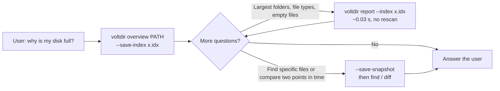
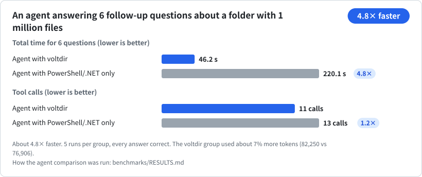

<p align="center"></p>

**Read in:** English · [正體中文](README.zh-TW.md) · [简体中文](README.zh-CN.md) · [한국어](README.ko.md) · [日本語](README.ja.md) · [Tiếng Việt](README.vi.md)

**Windows disk analysis built for AI agents.** One call tells you what is filling a drive: the largest folders, which file types take the most space, where the empty files are, and what changed since last week. Read-only, a single executable, and stable JSON output.

| A folder with 1 million files | All of `C:\` (administrator) | An agent answering 6 follow-up questions |
|:---:|:---:|:---:|
| **About 11× less memory**<br>14.7 MB vs 163 MB | **About 5.7× faster**<br>6.6 s vs 37.5 s | **About 4.8× faster**<br>46 s vs 220 s |

Each comparison is against the best of several well-written PowerShell/.NET baselines, median of 5 runs. The full numbers, **including where voltdir does not win yet**, are in [`benchmarks/RESULTS.md`](benchmarks/RESULTS.md). The scripts in [`benchmarks/`](benchmarks/README.md) reproduce them on your own machine.

- **Read-only.** voltdir reads names, sizes, timestamps and attributes. It never reads file contents, never deletes or moves anything, never touches the network, and never elevates itself.
- **One `voltdir.exe`** (x64, about 0.75 MB). The C runtime is linked statically and only built-in Windows DLLs are imported. No third-party dependencies to install.
- **An agent skill.** [`skills/voltdir/SKILL.md`](skills/voltdir/SKILL.md) (about 4,500 characters) ships with the executable and starts every task with `overview`.
- Status: **v1 candidate**, Windows x64 only.

---

## Install

### As a Claude Code plugin

```text
/plugin marketplace add CubeLink-oss/voltdir
/plugin install voltdir@voltdir
```

The plugin contains the skill and a prebuilt `voltdir.exe` ([`skills/voltdir/bin/`](skills/voltdir/bin)). Your agent picks it up for questions like "why is my disk full?", "find the big files" or "what grew this week?".

### As a standalone executable

Copy [`skills/voltdir/bin/voltdir.exe`](skills/voltdir/bin) into any folder. There is nothing to install. The binary is not code-signed yet, so Windows SmartScreen may warn you the first time you run it. Before you do, you can confirm it was built from this source; see [Verify the bundled binary](#verify-the-bundled-binary).

---

## Quick start

```powershell
# First call: totals, largest folders and files, file types, large stale files, empty files,
# plus ready-to-run "next" commands
voltdir overview D:\Projects

# Save a compact index during the same scan; follow-up questions no longer rescan
voltdir overview D:\Projects --save-index C:\Temp\p.idx
voltdir report --index C:\Temp\p.idx --top-dirs 20 --by-ext 15

# Save a full snapshot only when you need find or diff
voltdir overview D:\Projects --save-snapshot C:\Temp\p.ndjson
voltdir find --snapshot C:\Temp\p.ndjson --ext .log --min-size 100M --sort size --limit 20
voltdir diff C:\Temp\monday.ndjson C:\Temp\friday.ndjson --match-roots
```

For a whole drive, run PowerShell **as administrator** so voltdir can use the `mft` engine, which reads the NTFS Master File Table directly. Without elevation it falls back to the `walk` engine; some system folders will be unreadable, and `coverage` in the output lists every one of them.

### How an agent uses it



---

## Benchmarks

Every number below comes from the reproducible benchmarks in `benchmarks\`. Each cell is the median of 5 runs, and runs measured while background processes were busy are flagged as noisy.

### Memory: a folder with 1 million files


voltdir aggregates as it streams: once a folder is finished it is folded into its parent, so no per-file records are kept. Most of the baseline's 163 MB is the `pwsh` host itself; a natively compiled .NET program would use less.

### All of C:\ (administrator)


### An agent answering follow-up questions



Same model, same questions, same permissions, 5 runs per group, every answer correct. The gap comes from the follow-ups: with a saved index each one takes about 3–8 s, while the baseline agent spends 7–33 s recomputing. Agent-level runs need an agent harness; the method is described in [`benchmarks/RESULTS.md`](benchmarks/RESULTS.md).

### Where voltdir does not win yet


| Area | Where it stands |
|---|---|
| Single scan without elevation | Only about 1.7× faster than the best .NET baseline on 1 million files, and slower on all of `C:\` (0.78×). The bottleneck is the cost of opening directories on NTFS. |
| Token usage | About the same as the baseline; the voltdir group used 4–10% more. Each agent call carries roughly 73,000 tokens of fixed overhead that no tool can reduce. |
| Memory for an elevated full-drive scan | 186 MB, on par with a streaming .NET script (177 MB), not ahead of it. |

The reasons are explained in [`benchmarks/RESULTS.md`](benchmarks/RESULTS.md).

---

## Commands

| Command | What it does | Output |
|---|---|---|
| `overview <PATH>... \| --snapshot <FILE> \| --index <FILE>` | **Answers the common questions in one call** (about 3 KB): totals, largest folders and files, file types, large stale files, empty files and folders, unreadable locations, and ready-to-run `next` commands. Options: `--save-index`, `--save-snapshot`, `--rank physical\|logical`, `--dir-rank rollup\|direct`, `--detail concise\|full` | One JSON document (`voltdir.overview/1`) |
| `report <PATH>... \| --snapshot <FILE> \| --index <FILE>` | Direct aggregates: `--top-files`, `--top-dirs`, `--by-ext`, `--many-files` | One JSON document (`voltdir.report/1`) |
| `find <PATH>... \| --snapshot <FILE>` | Search by name (wildcards or `--name-regex`), path, type, extension, size, date, or emptiness | One JSON document (`voltdir.find/1`) |
| `diff <A> <B>` | Compare two snapshots: grown, shrunk, added, removed. For snapshots of different paths, add `--match-roots` (or `--a-root` / `--b-root`) | One JSON document (`voltdir.diff/1`) |
| `scan <PATH>... --out <FILE>` | Writes a **snapshot** only. `--out` is required because snapshots can run to hundreds of MB; use `--out -` to write to stdout explicitly | NDJSON (`voltdir.snapshot/1`) |
| `info` | Environment and capabilities: version, elevation, engines, volumes | One JSON document |

Common options: `--out <FILE|->`, `--engine auto|mft|walk`, `--threads <N>`, `--exclude <GLOB>`, `--follow-links mount|symlink|junction`, `--hardlinks dedupe|none`, `--timeout-sec <N>`, `-q`. For the full syntax, run `voltdir --help` or `voltdir help <command>`.

## Two engines

| | `walk` | `mft` |
|---|---|---|
| Needs administrator | No | **Yes** (reads the volume's MFT) |
| Scope | Any folder on any file system | Only the **root** of a local NTFS drive, such as `C:\` |
| All of `C:\` (about 3.1 million files) | About 54 s | **About 6.6 s, 186 MB peak** |
| What you see | Limited by permissions; reserved entries such as `$MFT` are not visible | Reserved entries (marked `reserved: true`) and the contents of `System Volume Information` |

`--engine auto` (the default) uses `mft` when it can and otherwise falls back to `walk`, saying why on stderr. `--engine mft` is strict: if the engine is unavailable, voltdir exits with code 3.

## Exit codes

| Code | Meaning |
|---|---|
| 0 | Complete success |
| 1 | Usage error, including an unusable snapshot or index, or a `diff` between snapshots whose roots do not overlap without `--match-roots` |
| 2 | The result is valid, but **some folders could not be read** (usually access denied). `coverage` lists them; **do not treat the result as complete** |
| 3 | The requested engine is unavailable (for example `--engine mft` without elevation, or a non-NTFS volume) |
| 4 | Writing the output file failed (no partial file is left behind) |
| 5 | Timed out or cancelled (whatever was scanned is still written) |

## Output format

- Paths are in Win32 form, without the `\\?\` prefix. Unpaired UTF-16 surrogates are escaped as `\uXXXX`, so nothing is lost. Control characters and bidirectional-text characters are always escaped, so a crafted file name cannot smuggle instructions into an agent's context.
- Timestamps are RFC 3339 in UTC; sizes are integers in bytes. `size_logical` is the end-of-file position, `size_physical` is the space actually allocated on disk.
- Output order is fixed: the same input with the same engine produces byte-for-byte identical output.
- **Hard links** count once toward physical size and once per name toward logical size.

## Build and test

Requires Rust 1.94 or later with the MSVC toolchain.

```powershell
cargo build --release          # produces target\release\voltdir.exe
.\scripts\ci.ps1               # formatting, clippy, all tests, license check, benchmark-script self-tests, skill checks
```

To reproduce the benchmarks, see [`benchmarks/README.md`](benchmarks/README.md).

## Verify the bundled binary

The `voltdir.exe` in [`skills/voltdir/bin/`](skills/voltdir/bin) is not a separate download. It is built from the source in this repository with `cargo build --release`, and its SHA-256 is recorded next to it in `voltdir.exe.sha256`. The build is deterministic: the linker runs with `/Brepro`, so the binary contains no timestamps and no paths from the build machine. With the same commit and the same toolchain, you get the same bytes.

The published binary was built with **Rust 1.94.0** (`x86_64-pc-windows-msvc`). To check it yourself:

```powershell
git clone https://github.com/CubeLink-oss/voltdir
cd voltdir
rustup toolchain install 1.94.0
cargo +1.94.0 build --release
(Get-FileHash target\release\voltdir.exe -Algorithm SHA256).Hash
Get-Content skills\voltdir\bin\voltdir.exe.sha256
```

The two hashes should match (the first is printed in upper case). If they do not, check that you are on the same commit and that `rustc +1.94.0 -V` reports 1.94.0; a different version of the MSVC linker can also change the bytes. If you would rather not run a binary you did not build, use your own `target\release\voltdir.exe` instead; the skill also accepts `voltdir` on your `PATH`.

Some security scanners flag any skill that bundles an executable. That warning is expected here, and the steps above are how you settle it.

## Repository layout

| Path | Contents |
|---|---|
| [`skills/voltdir/`](skills/voltdir) | The agent skill: [`SKILL.md`](skills/voltdir/SKILL.md), the full [`reference.md`](skills/voltdir/reference.md), and the prebuilt `bin/voltdir.exe` |
| [`.claude-plugin/`](.claude-plugin) | Claude Code plugin and marketplace manifests |
| [`benchmarks/`](benchmarks/README.md) | Reproducible benchmark scripts and the [results summary](benchmarks/RESULTS.md) |
| `src/`, `tests/` | Source code and tests |
| `scripts/` | CI, license check, test-data generators |

## License

[Apache License 2.0](LICENSE). Copyright holders are listed in [`NOTICE`](NOTICE).
