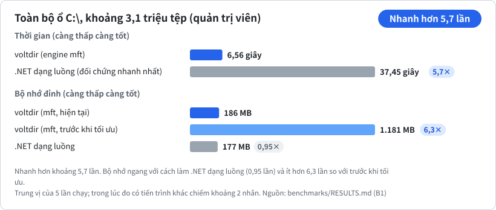
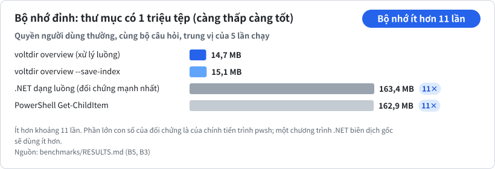
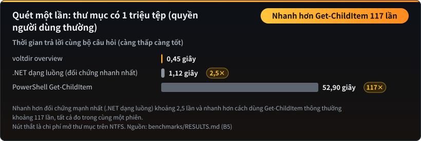
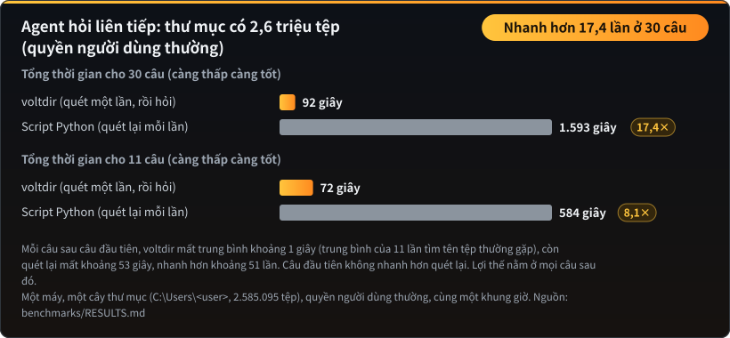

<p align="center"></p>

**Đọc bằng:** [English](README.md) · [正體中文](README.zh-TW.md) · [简体中文](README.zh-CN.md) · [한국어](README.ko.md) · [日本語](README.ja.md) · Tiếng Việt

**Quét một lần, sau đó hỏi bao nhiêu câu tùy ý, mỗi câu khoảng một giây.**

**Công cụ phân tích ổ đĩa Windows dành cho AI agent.** Chỉ một lệnh gọi là biết thứ gì đang chiếm chỗ trên ổ đĩa: thư mục lớn nhất, loại tệp tốn dung lượng nhất, tệp rỗng nằm ở đâu, và những gì mới tăng lên trong vài ngày qua. Chỉ đọc, một tệp thực thi duy nhất, đầu ra JSON có định dạng cố định.

| Toàn bộ `C:\` (quản trị viên) | Bộ nhớ, 1 triệu tệp | Quét một lần, 1 triệu tệp | Agent hỏi liên tiếp |
|:---:|:---:|:---:|:---:|
| **nhanh hơn 5,7 lần**<br>6,6 giây so với 37,5 giây | **ít hơn 11 lần**<br>14 MB so với 163 MB | **nhanh hơn tới 117 lần**<br>so với Get-ChildItem; 2,5 lần so với mã .NET tốt nhất | **nhanh hơn 17,4 lần**<br>30 câu liên tiếp, mỗi câu khoảng 1 giây |

> **Câu hỏi đầu tiên tốn thời gian như bất kỳ lần quét nào.** voltdir quét thư mục và dựng chỉ mục, và một script Python cẩn thận cũng không chậm hơn ở bước này (0,9 lần trên 2,6 triệu tệp). Lợi thế nằm ở mọi câu hỏi sau đó. Những chỗ voltdir chưa thắng được liệt kê bên dưới.

**Toàn bộ `C:\` (quản trị viên): nhanh hơn 5,7 lần, 6,6 giây so với 37,5 giây.**



**Bộ nhớ, thư mục 1 triệu tệp: ít hơn khoảng 11 lần.**



**Quét một lần thư mục 1 triệu tệp: nhanh hơn tới 117 lần so với script Get-ChildItem thông thường, và 2,5 lần so với mã .NET mạnh nhất.**



**Agent hỏi liên tiếp thay bạn: nhanh hơn 17,4 lần ở 30 câu, mỗi câu khoảng 1 giây.**



Số liệu đo trên các thư mục thật, so với những cách làm đối chứng được viết cẩn thận. Mọi con số (**kể cả chỗ voltdir chưa thắng**) nằm trong [`benchmarks/RESULTS.md`](benchmarks/RESULTS.md), toàn bộ biểu đồ ở [trang benchmark](BENCHMARKS.vi.md), và các script trong [`benchmarks/`](benchmarks/README.md) giúp bạn tái hiện trên máy của mình.

- **Chỉ đọc:** voltdir chỉ đọc tên, kích thước, thời gian và thuộc tính. Không đọc nội dung tệp, không xóa, không di chuyển, không kết nối mạng và không tự nâng quyền.
- **Một tệp `voltdir.exe` duy nhất** (x64, khoảng 0,75 MB): liên kết tĩnh C runtime, chỉ nạp các DLL có sẵn của Windows, không cần cài thêm thư viện phụ thuộc nào.
- **Skill cho agent:** [`skills/voltdir/SKILL.md`](skills/voltdir/SKILL.md) (khoảng 5.600 ký tự) đi kèm tệp thực thi đã build sẵn, và bước đầu tiên luôn là `overview`.
- Trạng thái: **ứng viên v1**, chỉ hỗ trợ Windows x64.

## Cứ nói bằng lời thường

Bạn không cần viết mẫu tìm kiếm nào. Bạn nói với agent điều mình muốn, agent chuyển thành một lần tìm kiếm, còn voltdir trả lời từ chỉ mục mà không đọc nội dung của bất kỳ tệp nào.

| Bạn nói | voltdir tìm ra |
|---|---|
| “Zalo và WeChat cứ tự tải PDF về, tìm hết và phân loại giúp tôi” | Mọi tệp PDF trên các ổ đĩa bạn chỉ định (`C:` hay `F:` đều được): đến từ đâu (thư mục của ứng dụng nhắn tin, Downloads, màn hình nền), cũ đến mức nào, dung lượng, tệp nào giống hóa đơn hoặc hợp đồng, tệp nào trùng, dưới dạng danh sách để bạn quyết định |
| “Sắp xếp giúp tôi ảnh chụp từ điện thoại” | Ảnh từ máy ảnh và điện thoại (`IMG_0001.JPG`, `PXL_…heic`), kèm thư mục, dung lượng và ngày của từng ảnh |
| “Dọn giúp tôi các ảnh chụp màn hình” | Mọi tệp có tên kiểu `Ảnh chụp màn hình 2026-01-02.png`, dù lưu ở đâu |
| “Thư mục Downloads có nhiều bản trùng không?” | Các bản sao như `báo cáo (1).pdf` và `báo cáo - Copy.docx`, dưới dạng danh sách ứng viên |
| “Cái nào xóa đi cũng an toàn?” | Tệp tạm còn sót (`.bak`, `.old`, `.tmp`, tệp tải dở), trình cài đặt cũ và thư mục rỗng, kèm dung lượng và độ cũ. Đây là danh sách để bạn quyết định; voltdir không bao giờ xóa gì |
| “Tìm giúp hóa đơn để khai thuế” | Các tệp có tên chứa `hóa đơn` hoặc `biên lai`; không mở tệp nào |
| “Máy tôi có bao nhiêu dự án?” | Các thư mục chứa `package.json`, `Cargo.toml`, `pyproject.toml` hoặc `go.mod` |

Các mẫu tìm kiếm mà agent thực sự dùng đã được kiểm thử và liệt kê trong [`skills/voltdir/reference.md`](skills/voltdir/reference.md).

### Các tệp PDF mà ứng dụng nhắn tin tự tải về

Zalo, Messenger, WeChat và các ứng dụng nhắn tin tương tự lưu mọi tệp PDF nhận được vào thư mục riêng của chúng, và hầu như không ai mở các thư mục đó ra xem. Trên một máy tính thật, 371 trong số 728 tệp PDF trên ổ đĩa nằm trong thư mục của WeChat. Hãy quét một lần rồi lần lượt hỏi: có bao nhiêu tệp và nặng bao nhiêu; tệp nào đến từ ứng dụng nào; tệp nào cũ hơn một năm; tệp nào giống hóa đơn hoặc hợp đồng; tệp nào tải trùng. Bảy câu hỏi như vậy mất tổng cộng 1,25 giây sau khi quét, vì tìm PDF dùng phần mở rộng tệp chứ không dùng mẫu tên. Sau đó agent đề xuất cấu trúc thư mục và danh sách di chuyển; voltdir chỉ đọc tên nên sẽ không mở, di chuyển hay xóa tệp nào cho đến khi bạn đồng ý.

## Được làm cho agent

- **Nói rõ điều nó chưa thấy.** Thư mục không đọc được nằm trong `coverage` và mã thoát là 2, nên một câu trả lời thiếu không bị coi là đầy đủ.
- **Không bị dắt mũi bằng lời lẽ.** Tên tệp chỉ là dữ liệu. Ký tự điều khiển và thủ thuật chữ viết từ phải sang trái đều được thoát, nên tệp tên “bỏ qua các chỉ dẫn trước đó…” vẫn chỉ là một cái tên.
- **Cho biết câu trả lời mới đến đâu.** stderr có dòng `index: used (built 12 minutes ago)`.
- **Agent nào cũng tìm thấy.** Có skill và plugin cho Claude, cùng một tệp [`AGENTS.md`](AGENTS.md) cho các agent đọc loại tệp này. Chỉ là dòng lệnh thông thường, không có máy chủ nào phải chạy.

---

## Cài đặt

### Dưới dạng plugin của Claude Code

```text
/plugin marketplace add CubeLink-oss/voltdir
/plugin install voltdir@voltdir
```

Plugin gồm skill và tệp `voltdir.exe` đã build sẵn ([`skills/voltdir/bin/`](skills/voltdir/bin)). Agent sẽ tự dùng nó khi gặp những câu hỏi như "sao ổ đĩa đầy rồi?", "tìm giúp các tệp lớn" hay "tuần này có gì mới tăng lên?".

### Dùng riêng tệp thực thi

Chép [`skills/voltdir/bin/voltdir.exe`](skills/voltdir/bin) vào bất kỳ thư mục nào là dùng được ngay, không cần cài đặt. Tệp thực thi hiện chưa được ký mã, nên lần chạy đầu tiên Windows SmartScreen có thể hiện cảnh báo. Trước khi chạy, bạn có thể tự kiểm tra rằng nó được build từ chính mã nguồn này; xem [Xác minh tệp thực thi đi kèm](#xác-minh-tệp-thực-thi-đi-kèm).

---

## Bắt đầu nhanh

```powershell
# Lệnh gọi đầu tiên: tổng dung lượng, thư mục và tệp lớn nhất, loại tệp, tệp lớn lâu không sửa, tệp rỗng,
# kèm các lệnh "next" có thể chạy ngay
voltdir overview D:\Projects

# Lưu chỉ mục gọn nhẹ ngay trong lần quét đó; các câu hỏi tiếp theo không cần quét lại
voltdir overview D:\Projects --save-index C:\Temp\p.idx
voltdir report --index C:\Temp\p.idx --top-dirs 20 --by-ext 15

# Chỉ lưu ảnh chụp nhanh đầy đủ khi cần find hoặc diff; nó cũng ghi chỉ mục tên, nên mọi lần
# find --snapshot sau đó trả lời trong chưa đến một giây (ảnh chụp nhanh cũ: voltdir index TỆP)
voltdir overview D:\Projects --save-snapshot C:\Temp\p.ndjson
voltdir find --snapshot C:\Temp\p.ndjson --ext .log --min-size 100M --sort size --limit 20
voltdir diff C:\Temp\monday.ndjson C:\Temp\friday.ndjson --match-roots
```

Khi quét cả ổ đĩa, hãy mở PowerShell **với quyền quản trị viên** để voltdir dùng được engine `mft`, vốn đọc trực tiếp bảng tệp chính (MFT) của NTFS. Nếu không có quyền quản trị, voltdir tự chuyển sang engine `walk`; một số thư mục hệ thống sẽ không đọc được, và mục `coverage` trong đầu ra liệt kê đầy đủ từng vị trí đó.

---

## Kết quả đo hiệu năng

Toàn bộ biểu đồ (bộ nhớ, cả ổ đĩa, agent hỏi nối tiếp, quét một lần, so với script Python thông thường) ở **[trang benchmark](BENCHMARKS.vi.md)**, số liệu trong [`benchmarks/RESULTS.md`](benchmarks/RESULTS.md).

### Những chỗ voltdir chưa thắng

| Hạng mục | Hiện trạng |
|---|---|
| Câu hỏi đầu tiên | Không nhanh hơn một script Python cẩn thận khi quét bằng quyền người dùng thường; cả hai đều chờ cùng chi phí mở thư mục NTFS (0,9 lần trên 2,6 triệu tệp). Lợi thế nằm ở các câu hỏi sau đó. |
| Tìm kiếm bằng biểu thức chính quy | Tìm kiếm có nhiều lựa chọn mất khoảng 2 giây trên 2,6 triệu tên; bộ so khớp chưa được tối ưu. |
| Quét một lần không có quyền quản trị | Với 1 triệu tệp nhanh hơn phương án .NET tốt nhất khoảng 2,5 lần, nhưng với toàn bộ `C:\` thì chậm hơn (0,78 lần). Nút thắt là chi phí mở thư mục trên NTFS |
| Lượng token | Gần như tương đương phương án đối chứng; nhóm voltdir dùng nhiều hơn 4–10%. Mỗi lần gọi agent có khoảng 73.000 token chi phí cố định mà không công cụ nào giảm được |
| Bộ nhớ khi quét cả ổ với quyền quản trị | 186 MB, ngang với cách viết .NET dạng luồng (177 MB), không vượt trội |

Nguyên nhân được giải thích trong [`benchmarks/RESULTS.md`](benchmarks/RESULTS.md).

## Điểm mạnh và những điều cần lưu ý

**Điểm mạnh**

- **Số lượng đáng tin.** Junction và liên kết cứng được xử lý nên tổng số khớp với thực tế (xem [trang benchmark](BENCHMARKS.vi.md)).
- **Không bỏ sót âm thầm.** Khi có thư mục không đọc được, mã thoát là 2 và `coverage` liệt kê từng nơi.
- **Câu hỏi tiếp theo rất rẻ.** Có chỉ mục rồi thì mỗi câu khoảng 0,05 giây.
- **Đầu ra ổn định.** Cùng đầu vào, cùng engine thì JSON giống nhau đến từng byte.

**Do một đánh giá độc lập tìm ra, đã sửa ở 0.0.2.** Chúng tôi thử voltdir theo cách một agent thực sự dùng, và sửa mọi điều hóa ra là lỗi.

- Mẫu viết bằng dấu gạch chéo xuôi (`--exclude "*/node_modules/*"`, `--path "*/src/*"`) trước đây không khớp với gì cả, và âm thầm như vậy: lệnh vẫn thành công nhưng không loại trừ gì. Giờ `/` và `\` có cùng ý nghĩa trong mọi mẫu.
- Mẫu `--exclude` không khớp với đường dẫn nào giờ sẽ in cảnh báo ra stderr, nên gõ nhầm sẽ không còn lọt qua mà không ai biết.
- Mọi lệnh đều chấp nhận `--json` (không thay đổi gì, đầu ra luôn là JSON) và `--follow-links none` (đó là mặc định).
- `--help` giờ nói rõ mã thoát 2 là bình thường khi quét cả ổ đĩa, và engine `mft` cần những gì.

**Những điều cần biết** (theo thiết kế, không phải lỗi)

| Hành vi | Lý do | Cách làm |
|---|---|---|
| `find --snapshot ... --exclude` báo lỗi | Tùy chọn quét chỉ có tác dụng khi quét, không dùng khi đọc ảnh chụp nhanh | Loại trừ ngay lúc quét (`scan --exclude`), hoặc lọc bằng `--path` |
| Quét cả ổ đĩa trả về mã thoát 2 | Các thư mục hệ thống như thùng rác không đọc được; kết quả vẫn hợp lệ và `coverage` liệt kê chúng | Trong script, coi 2 là "hoàn tất kèm cảnh báo", đừng coi là thất bại |
| `find --limit` giữ các kết quả đầu theo thứ tự đường dẫn (mặc định 100) | Nếu không yêu cầu khác, kết quả được sắp theo đường dẫn | Dùng `--sort size` và so `matched_total` với số mục trong danh sách |
| Lợi thế về tốc độ phụ thuộc hình dạng của cây thư mục | Khoảng 5 lần so với vòng lặp Python trên thư mục 1 triệu tệp, khoảng 2 lần trên không gian làm việc hoặc cả ổ đĩa (xem [trang benchmark](BENCHMARKS.vi.md)) | Chạy bài đo trên chính thư mục của bạn |

---

## Các lệnh

| Lệnh | Công dụng | Đầu ra |
|---|---|---|
| `overview <PATH>... \| --snapshot <FILE> \| --index <FILE>` | **Trả lời các câu hỏi thường gặp trong một lần gọi** (khoảng 3 KB): tổng dung lượng, thư mục và tệp lớn nhất, phân bố loại tệp, tệp lớn lâu không sửa, tệp rỗng và thư mục rỗng, các vị trí không đọc được, cùng các lệnh `next` có thể chạy ngay. Tùy chọn: `--save-index`, `--save-snapshot`, `--rank physical\|logical`, `--dir-rank rollup\|direct`, `--detail concise\|full` | Một tài liệu JSON (`voltdir.overview/1`) |
| `report <PATH>... \| --snapshot <FILE> \| --index <FILE>` | Tổng hợp trực tiếp: `--top-files`, `--top-dirs`, `--by-ext`, `--many-files` | Một tài liệu JSON (`voltdir.report/1`) |
| `find <PATH>... \| --snapshot <FILE>` | Tìm theo tên (ký tự đại diện hoặc `--name-regex`), đường dẫn, loại, phần mở rộng, kích thước, ngày, hoặc rỗng hay không | Một tài liệu JSON (`voltdir.find/1`) |
| `diff <A> <B>` | So sánh hai ảnh chụp nhanh: tăng lên, giảm đi, mới thêm, biến mất. Với hai ảnh chụp nhanh có đường dẫn khác nhau, thêm `--match-roots` (hoặc `--a-root` / `--b-root`) | Một tài liệu JSON (`voltdir.diff/1`) |
| `scan <PATH>... --out <FILE>` | Chỉ xuất **ảnh chụp nhanh**. Ảnh chụp nhanh có thể lên tới hàng trăm MB nên bắt buộc có `--out`; muốn xuất ra stdout thì ghi rõ `--out -` | NDJSON (`voltdir.snapshot/1`) |
| `info` | Môi trường và khả năng: phiên bản, có nâng quyền hay không, các engine, các ổ đĩa | Một tài liệu JSON |

Tùy chọn thường dùng: `--out <FILE|->`, `--engine auto|mft|walk`, `--threads <N>`, `--exclude <GLOB>`, `--follow-links mount|symlink|junction`, `--hardlinks dedupe|none`, `--timeout-sec <N>`, `-q`. Để xem cú pháp đầy đủ, chạy `voltdir --help` hoặc `voltdir help <lệnh>`.

## Hai engine

| | `walk` | `mft` |
|---|---|---|
| Cần quyền quản trị | Không | **Có** (đọc MFT của ổ đĩa) |
| Phạm vi | Mọi thư mục, mọi hệ thống tệp | Chỉ **thư mục gốc** của ổ NTFS cục bộ, ví dụ `C:\` |
| Toàn bộ `C:\` (khoảng 3,1 triệu tệp) | Khoảng 54 giây | **Khoảng 6,6 giây, đỉnh 186 MB** |
| Những gì thấy được | Bị giới hạn bởi quyền; không thấy các mục dành riêng như `$MFT` | Thấy cả các mục dành riêng (đánh dấu `reserved: true`) và nội dung của `System Volume Information` |

`--engine auto` (mặc định) dùng `mft` khi đủ điều kiện, nếu không thì chuyển sang `walk` và nêu lý do trên stderr. `--engine mft` là chế độ nghiêm ngặt: nếu engine không dùng được, voltdir kết thúc với mã 3.

## Mã thoát

| Mã | Ý nghĩa |
|---|---|
| 0 | Thành công trọn vẹn |
| 1 | Sai cách dùng, kể cả ảnh chụp nhanh hoặc chỉ mục không dùng được, hay `diff` hai ảnh chụp nhanh có thư mục gốc không trùng nhau mà không có `--match-roots` |
| 2 | Kết quả hợp lệ nhưng **có thư mục không đọc được** (thường do bị từ chối truy cập). `coverage` liệt kê các vị trí đó; **không được coi là kết quả đầy đủ** |
| 3 | Engine được chỉ định không dùng được (ví dụ `--engine mft` khi không có quyền quản trị, hoặc ổ đĩa không phải NTFS) |
| 4 | Ghi tệp đầu ra thất bại (không để lại tệp ghi dở) |
| 5 | Hết thời gian hoặc bị hủy (phần đã quét vẫn được xuất ra) |

## Những điểm chính về định dạng đầu ra

- Đường dẫn ở dạng Win32, không có tiền tố `\\?\`. Các ký tự thay thế UTF-16 không thành cặp được thoát thành `\uXXXX` nên không bị mất. Ký tự điều khiển và ký tự văn bản hai chiều luôn được thoát, để không ai có thể dùng tên tệp được tạo có chủ đích nhằm chèn lệnh vào ngữ cảnh của agent.
- Thời gian theo RFC 3339 ở múi giờ UTC; kích thước là số nguyên tính bằng byte. `size_logical` là vị trí cuối tệp, `size_physical` là dung lượng thực sự được cấp phát trên đĩa.
- Thứ tự đầu ra cố định: cùng đầu vào, cùng engine thì đầu ra giống nhau đến từng byte.
- **Liên kết cứng** chỉ được tính một lần vào kích thước thực, nhưng được tính theo từng tên vào kích thước logic.

## Build và kiểm thử

Cần Rust 1.94 trở lên (bộ công cụ MSVC).

```powershell
cargo build --release          # tạo ra target\release\voltdir.exe
.\scripts\ci.ps1               # định dạng, clippy, toàn bộ kiểm thử, kiểm tra giấy phép, tự kiểm tra tập lệnh đo, kiểm tra skill
```

Cách tái lập các bài đo có trong [`benchmarks/README.md`](benchmarks/README.md).

## Xác minh tệp thực thi đi kèm

Tệp `voltdir.exe` trong [`skills/voltdir/bin/`](skills/voltdir/bin) không phải tệp tải từ nơi khác: nó được build từ chính mã nguồn của kho này bằng `cargo build --release`, và mã băm SHA-256 được ghi ngay bên cạnh trong `voltdir.exe.sha256`. Quá trình build mang tính tất định: trình liên kết chạy với `/Brepro`, nên tệp thực thi không chứa dấu thời gian hay đường dẫn nào của máy build. Cùng một commit và cùng bộ công cụ sẽ cho ra đúng những byte đó.

Tệp thực thi được công bố build bằng **Rust 1.94.0** (`x86_64-pc-windows-msvc`). Để tự kiểm tra:

```powershell
git clone https://github.com/CubeLink-oss/voltdir
cd voltdir
rustup toolchain install 1.94.0
cargo +1.94.0 build --release
(Get-FileHash target\release\voltdir.exe -Algorithm SHA256).Hash
Get-Content skills\voltdir\bin\voltdir.exe.sha256
```

Hai mã băm phải trùng nhau (mã đầu được in chữ hoa). Nếu không trùng, hãy kiểm tra bạn đang ở cùng commit và `rustc +1.94.0 -V` báo 1.94.0; phiên bản trình liên kết MSVC khác cũng có thể làm thay đổi các byte. Nếu không muốn chạy tệp không do chính mình build, hãy dùng `target\release\voltdir.exe` của bạn; skill cũng chấp nhận `voltdir` có trong `PATH`.

Một số trình quét bảo mật sẽ cảnh báo mọi skill có đi kèm tệp thực thi. Cảnh báo đó là dự kiến, và các bước trên chính là cách để bạn tự xác nhận.

## Cấu trúc kho mã

| Vị trí | Nội dung |
|---|---|
| [`skills/voltdir/`](skills/voltdir) | Skill cho agent: [`SKILL.md`](skills/voltdir/SKILL.md), tài liệu tham khảo đầy đủ [`reference.md`](skills/voltdir/reference.md), và tệp `bin/voltdir.exe` đã build sẵn |
| [`.claude-plugin/`](.claude-plugin) | Cấu hình plugin và marketplace của Claude Code |
| [`benchmarks/`](benchmarks/README.md) | Các tập lệnh đo có thể tái lập và [bản tóm tắt kết quả](benchmarks/RESULTS.md) |
| `src/`, `tests/` | Mã nguồn và kiểm thử |
| `scripts/` | CI, kiểm tra giấy phép, công cụ tạo dữ liệu kiểm thử |

## Quyền riêng tư

voltdir chạy hoàn toàn trên máy tính của bạn. Nó chỉ đọc tên, kích thước, thời gian và thuộc tính (không đọc nội dung tệp), không mở kết nối mạng và không thu thập gì. Nó chỉ ghi các tệp bạn yêu cầu bằng `--out`, `--save-index` và `--save-snapshot`; các tệp này chứa đường dẫn tệp, nên hãy coi là dữ liệu nhạy cảm. Khi một AI agent chạy voltdir, agent đọc kết quả đầu ra và nó trở thành một phần của cuộc trò chuyện giữa bạn và agent. Skill đi kèm yêu cầu agent xác nhận với bạn trước khi quét cả ổ đĩa, thư mục cá nhân hoặc thư mục trông có vẻ riêng tư, trừ khi chính bạn chỉ định thư mục đó. Nội dung đầy đủ nằm trong [`PRIVACY.md`](PRIVACY.md) (tiếng Anh). Câu hỏi và báo lỗi: [GitHub Issues](https://github.com/CubeLink-oss/voltdir/issues).

## Giấy phép

[Apache License 2.0](LICENSE). Chủ sở hữu bản quyền được liệt kê trong [`NOTICE`](NOTICE).
