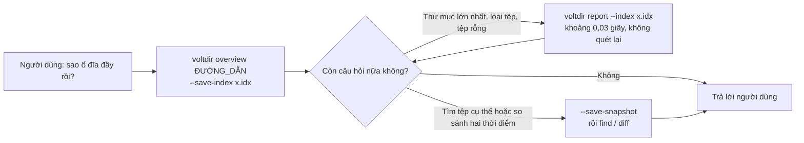

# voltdir

**Đọc bằng:** [English](README.md) · [正體中文](README.zh-TW.md) · [简体中文](README.zh-CN.md) · [한국어](README.ko.md) · [日本語](README.ja.md) · Tiếng Việt

**Công cụ phân tích ổ đĩa Windows dành cho AI agent.** Chỉ một lệnh gọi là biết thứ gì đang chiếm chỗ trên ổ đĩa: thư mục lớn nhất, loại tệp tốn dung lượng nhất, tệp rỗng nằm ở đâu, và những gì mới tăng lên trong vài ngày qua. Chỉ đọc, một tệp thực thi duy nhất, đầu ra JSON có định dạng cố định.

| Thư mục có 1 triệu tệp | Toàn bộ `C:\` (quản trị viên) | Agent trả lời 6 câu hỏi nối tiếp |
|:---:|:---:|:---:|
| Bộ nhớ **ít hơn khoảng 11 lần**<br>14,7 MB so với 163 MB | **Nhanh hơn khoảng 5,7 lần**<br>6,6 giây so với 37,5 giây | **Nhanh hơn khoảng 4,8 lần**<br>46 giây so với 220 giây |

Mỗi phép so sánh lấy phương án nhanh nhất trong nhiều cách viết PowerShell/.NET tốt, là trung vị của 5 lần chạy. Số liệu đầy đủ, **kể cả những chỗ voltdir chưa thắng**, có trong [`benchmarks/RESULTS.md`](benchmarks/RESULTS.md); các tập lệnh trong [`benchmarks/`](benchmarks/README.md) cho phép bạn chạy lại trên máy của mình.

- **Chỉ đọc:** voltdir chỉ đọc tên, kích thước, thời gian và thuộc tính. Không đọc nội dung tệp, không xóa, không di chuyển, không kết nối mạng và không tự nâng quyền.
- **Một tệp `voltdir.exe` duy nhất** (x64, khoảng 0,75 MB): liên kết tĩnh C runtime, chỉ nạp các DLL có sẵn của Windows, không cần cài thêm thư viện phụ thuộc nào.
- **Skill cho agent:** [`skills/voltdir/SKILL.md`](skills/voltdir/SKILL.md) (khoảng 4.500 ký tự) đi kèm tệp thực thi đã build sẵn, và bước đầu tiên luôn là `overview`.
- Trạng thái: **ứng viên v1**, chỉ hỗ trợ Windows x64.

---

## Cài đặt

### Dưới dạng plugin của Claude Code

```text
/plugin marketplace add CubeLink-oss/voltdir
/plugin install voltdir@voltdir
```

Plugin gồm skill và tệp `voltdir.exe` đã build sẵn ([`skills/voltdir/bin/`](skills/voltdir/bin)). Agent sẽ tự dùng nó khi gặp những câu hỏi như "sao ổ đĩa đầy rồi?", "tìm giúp các tệp lớn" hay "tuần này có gì mới tăng lên?".

### Dùng riêng tệp thực thi

Chép [`skills/voltdir/bin/voltdir.exe`](skills/voltdir/bin) vào bất kỳ thư mục nào là dùng được ngay, không cần cài đặt. Tệp thực thi hiện chưa được ký mã, nên lần chạy đầu tiên Windows SmartScreen có thể hiện cảnh báo. Trước khi chạy, bạn có thể tự kiểm tra rằng nó được build từ chính mã nguồn này; xem [Xác minh tệp thực thi đi kèm](#xác-minh-tệp-thực-thi-đi-kèm).

---

## Bắt đầu nhanh

```powershell
# Lệnh gọi đầu tiên: tổng dung lượng, thư mục và tệp lớn nhất, loại tệp, tệp lớn lâu không sửa, tệp rỗng,
# kèm các lệnh "next" có thể chạy ngay
voltdir overview D:\Projects

# Lưu chỉ mục gọn nhẹ ngay trong lần quét đó; các câu hỏi tiếp theo không cần quét lại
voltdir overview D:\Projects --save-index C:\Temp\p.idx
voltdir report --index C:\Temp\p.idx --top-dirs 20 --by-ext 15

# Chỉ lưu bản chụp đầy đủ khi cần find hoặc diff
voltdir overview D:\Projects --save-snapshot C:\Temp\p.ndjson
voltdir find --snapshot C:\Temp\p.ndjson --ext .log --min-size 100M --sort size --limit 20
voltdir diff C:\Temp\monday.ndjson C:\Temp\friday.ndjson --match-roots
```

Khi quét cả ổ đĩa, hãy mở PowerShell **với quyền quản trị viên** để voltdir dùng được engine `mft`, vốn đọc trực tiếp bảng tệp chính (MFT) của NTFS. Nếu không có quyền quản trị, voltdir tự chuyển sang engine `walk`; một số thư mục hệ thống sẽ không đọc được, và mục `coverage` trong đầu ra liệt kê đầy đủ từng vị trí đó.

### Agent dùng voltdir như thế nào



---

## Kết quả đo hiệu năng

Mọi con số dưới đây đều lấy từ các bài đo có thể tái lập trong `benchmarks\`. Mỗi ô là trung vị của 5 lần chạy; lần đo nào có tiến trình nền đang dùng CPU đều được ghi chú là có nhiễu.

### Bộ nhớ: thư mục có 1 triệu tệp


voltdir tổng hợp ngay trong lúc duyệt: duyệt xong một thư mục là gộp kết quả vào thư mục cha, không giữ bản ghi cho từng tệp. Phần lớn 163 MB của phương án đối chứng là bản thân tiến trình `pwsh`; một chương trình .NET biên dịch gốc sẽ dùng ít hơn.

### Toàn bộ C:\ (quản trị viên)


### Agent trả lời các câu hỏi nối tiếp


Cùng một mô hình, cùng bộ câu hỏi, cùng quyền hạn, mỗi nhóm chạy 5 lần và đều trả lời đúng hết. Khoảng cách nằm ở các câu hỏi tiếp theo: khi đã lưu chỉ mục, mỗi câu mất khoảng 3–8 giây, còn agent đối chứng mất 7–33 giây để tính lại từ đầu. Phép so sánh ở cấp agent cần môi trường chạy agent; phương pháp được mô tả trong [`benchmarks/RESULTS.md`](benchmarks/RESULTS.md).

### Những chỗ voltdir chưa thắng


| Hạng mục | Hiện trạng |
|---|---|
| Quét một lần không có quyền quản trị | Với 1 triệu tệp chỉ nhanh hơn phương án .NET tốt nhất khoảng 1,7 lần, còn với toàn bộ `C:\` thì chậm hơn (0,78 lần). Nút thắt là chi phí mở thư mục trên NTFS |
| Lượng token | Gần như tương đương phương án đối chứng; nhóm voltdir dùng nhiều hơn 4–10%. Mỗi lần gọi agent có khoảng 73.000 token chi phí cố định mà không công cụ nào giảm được |
| Bộ nhớ khi quét cả ổ với quyền quản trị | 186 MB, ngang với cách viết .NET dạng luồng (177 MB), không vượt trội |

Nguyên nhân được giải thích trong [`benchmarks/RESULTS.md`](benchmarks/RESULTS.md).

---

## Các lệnh

| Lệnh | Công dụng | Đầu ra |
|---|---|---|
| `overview <PATH>... \| --snapshot <FILE> \| --index <FILE>` | **Trả lời các câu hỏi thường gặp trong một lần gọi** (khoảng 3 KB): tổng dung lượng, thư mục và tệp lớn nhất, phân bố loại tệp, tệp lớn lâu không sửa, tệp rỗng và thư mục rỗng, các vị trí không đọc được, cùng các lệnh `next` có thể chạy ngay. Tùy chọn: `--save-index`, `--save-snapshot`, `--rank physical\|logical`, `--dir-rank rollup\|direct`, `--detail concise\|full` | Một tài liệu JSON (`voltdir.overview/1`) |
| `report <PATH>... \| --snapshot <FILE> \| --index <FILE>` | Tổng hợp trực tiếp: `--top-files`, `--top-dirs`, `--by-ext`, `--many-files` | Một tài liệu JSON (`voltdir.report/1`) |
| `find <PATH>... \| --snapshot <FILE>` | Tìm theo tên (ký tự đại diện hoặc `--name-regex`), đường dẫn, loại, phần mở rộng, kích thước, ngày, hoặc rỗng hay không | Một tài liệu JSON (`voltdir.find/1`) |
| `diff <A> <B>` | So sánh hai bản chụp: tăng lên, giảm đi, mới thêm, biến mất. Với hai bản chụp có đường dẫn khác nhau, thêm `--match-roots` (hoặc `--a-root` / `--b-root`) | Một tài liệu JSON (`voltdir.diff/1`) |
| `scan <PATH>... --out <FILE>` | Chỉ xuất **bản chụp**. Bản chụp có thể lên tới hàng trăm MB nên bắt buộc có `--out`; muốn xuất ra stdout thì ghi rõ `--out -` | NDJSON (`voltdir.snapshot/1`) |
| `info` | Môi trường và khả năng: phiên bản, có nâng quyền hay không, các engine, các ổ đĩa | Một tài liệu JSON |

Tùy chọn thường dùng: `--out <FILE|->`, `--engine auto|mft|walk`, `--threads <N>`, `--exclude <GLOB>`, `--follow-links mount|symlink|junction`, `--hardlinks dedupe|none`, `--timeout-sec <N>`, `-q`. Để xem cú pháp đầy đủ, chạy `voltdir --help` hoặc `voltdir help <lệnh>`.

## Hai engine

| | `walk` | `mft` |
|---|---|---|
| Cần quyền quản trị | Không | **Có** (đọc MFT của ổ đĩa) |
| Phạm vi | Mọi thư mục, mọi hệ thống tệp | Chỉ **thư mục gốc** của ổ NTFS cục bộ, ví dụ `C:\` |
| Toàn bộ `C:\` (khoảng 3,1 triệu tệp) | Khoảng 54 giây | **Khoảng 6,6 giây, đỉnh 186 MB** |
| Những gì thấy được | Bị giới hạn bởi quyền; không thấy các mục dành riêng như `$MFT` | Thấy cả các mục dành riêng (đánh dấu `reserved: true`) và nội dung của `System Volume Information` |

`--engine auto` (mặc định) dùng `mft` khi đủ điều kiện, nếu không thì chuyển sang `walk` và nêu lý do trên stderr. `--engine mft` là chế độ nghiêm ngặt: nếu engine không dùng được, voltdir kết thúc với mã 3.

## Mã thoát

| Mã | Ý nghĩa |
|---|---|
| 0 | Thành công trọn vẹn |
| 1 | Sai cách dùng, kể cả bản chụp hoặc chỉ mục không dùng được, hay `diff` hai bản chụp có thư mục gốc không trùng nhau mà không có `--match-roots` |
| 2 | Kết quả hợp lệ nhưng **có thư mục không đọc được** (thường do bị từ chối truy cập). `coverage` liệt kê các vị trí đó; **không được coi là kết quả đầy đủ** |
| 3 | Engine được chỉ định không dùng được (ví dụ `--engine mft` khi không có quyền quản trị, hoặc ổ đĩa không phải NTFS) |
| 4 | Ghi tệp đầu ra thất bại (không để lại tệp ghi dở) |
| 5 | Hết thời gian hoặc bị hủy (phần đã quét vẫn được xuất ra) |

## Những điểm chính về định dạng đầu ra

- Đường dẫn ở dạng Win32, không có tiền tố `\\?\`. Các ký tự thay thế UTF-16 không thành cặp được thoát thành `\uXXXX` nên không bị mất. Ký tự điều khiển và ký tự văn bản hai chiều luôn được thoát, để không ai có thể dùng tên tệp được tạo có chủ đích nhằm chèn lệnh vào ngữ cảnh của agent.
- Thời gian theo RFC 3339 ở múi giờ UTC; kích thước là số nguyên tính bằng byte. `size_logical` là vị trí cuối tệp, `size_physical` là dung lượng thực sự được cấp phát trên đĩa.
- Thứ tự đầu ra cố định: cùng đầu vào, cùng engine thì đầu ra giống nhau đến từng byte.
- **Liên kết cứng** chỉ được tính một lần vào kích thước thực, nhưng được tính theo từng tên vào kích thước logic.

## Build và kiểm thử

Cần Rust 1.94 trở lên (bộ công cụ MSVC).

```powershell
cargo build --release          # tạo ra target\release\voltdir.exe
.\scripts\ci.ps1               # định dạng, clippy, toàn bộ kiểm thử, kiểm tra giấy phép, tự kiểm tra tập lệnh đo, kiểm tra skill
```

Cách tái lập các bài đo có trong [`benchmarks/README.md`](benchmarks/README.md).

## Xác minh tệp thực thi đi kèm

Tệp `voltdir.exe` trong [`skills/voltdir/bin/`](skills/voltdir/bin) không phải tệp tải từ nơi khác: nó được build từ chính mã nguồn của kho này bằng `cargo build --release`, và mã băm SHA-256 được ghi ngay bên cạnh trong `voltdir.exe.sha256`. Quá trình build mang tính tất định: trình liên kết chạy với `/Brepro`, nên tệp thực thi không chứa dấu thời gian hay đường dẫn nào của máy build. Cùng một commit và cùng bộ công cụ sẽ cho ra đúng những byte đó.

Tệp thực thi được công bố build bằng **Rust 1.94.0** (`x86_64-pc-windows-msvc`). Để tự kiểm tra:

```powershell
git clone https://github.com/CubeLink-oss/voltdir
cd voltdir
rustup toolchain install 1.94.0
cargo +1.94.0 build --release
(Get-FileHash target\release\voltdir.exe -Algorithm SHA256).Hash
Get-Content skills\voltdir\bin\voltdir.exe.sha256
```

Hai mã băm phải trùng nhau (mã đầu được in chữ hoa). Nếu không trùng, hãy kiểm tra bạn đang ở cùng commit và `rustc +1.94.0 -V` báo 1.94.0; phiên bản trình liên kết MSVC khác cũng có thể làm thay đổi các byte. Nếu không muốn chạy tệp không do chính mình build, hãy dùng `target\release\voltdir.exe` của bạn; skill cũng chấp nhận `voltdir` có trong `PATH`.

Một số trình quét bảo mật sẽ cảnh báo mọi skill có đi kèm tệp thực thi. Cảnh báo đó là dự kiến, và các bước trên chính là cách để bạn tự xác nhận.

## Cấu trúc kho mã

| Vị trí | Nội dung |
|---|---|
| [`skills/voltdir/`](skills/voltdir) | Skill cho agent: [`SKILL.md`](skills/voltdir/SKILL.md), tài liệu tham khảo đầy đủ [`reference.md`](skills/voltdir/reference.md), và tệp `bin/voltdir.exe` đã build sẵn |
| [`.claude-plugin/`](.claude-plugin) | Cấu hình plugin và marketplace của Claude Code |
| [`benchmarks/`](benchmarks/README.md) | Các tập lệnh đo có thể tái lập và [bản tóm tắt kết quả](benchmarks/RESULTS.md) |
| `src/`, `tests/` | Mã nguồn và kiểm thử |
| `scripts/` | CI, kiểm tra giấy phép, công cụ tạo dữ liệu kiểm thử |

## Giấy phép

[Apache License 2.0](LICENSE). Chủ sở hữu bản quyền được liệt kê trong [`NOTICE`](NOTICE).
