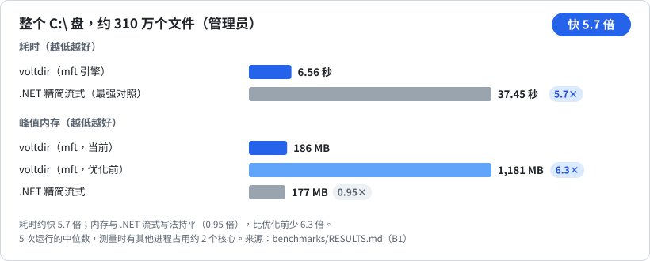
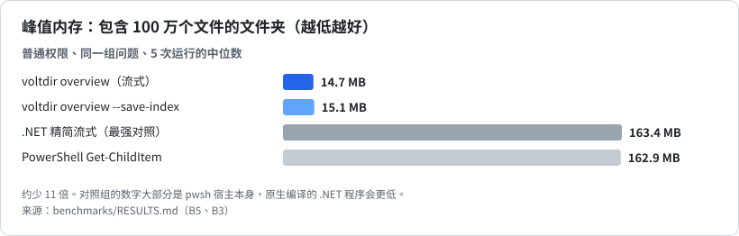
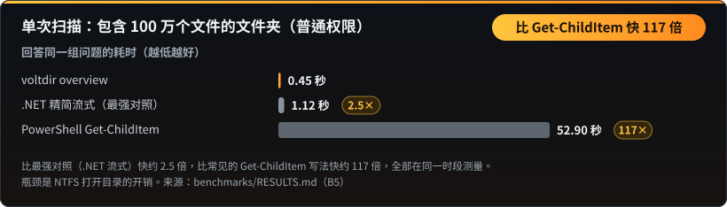

<p align="center"></p>

**阅读语言：** [English](README.md) · [正體中文](README.zh-TW.md) · 简体中文 · [한국어](README.ko.md) · [日本語](README.ja.md) · [Tiếng Việt](README.vi.md)

**扫描一次，之后想问几题都行，每题约一秒。**

**为 AI agent 打造的 Windows 磁盘分析工具。** 一次调用就能看清一块硬盘：哪里最大、哪种扩展名占得最多、哪里有空文件、这几天多了什么。只读、单个可执行文件、输出格式固定的 JSON。

| 整个 `C:\`（管理员） | 内存，100 万个文件 | 单次扫描，100 万个文件 | agent 连续提问 |
|:---:|:---:|:---:|:---:|
| **快 5.7 倍**<br>6.6 秒对 37.5 秒 | **少 11 倍**<br>14 MB 对 163 MB | **最高快 117 倍**<br>比 Get-ChildItem；比最强的 .NET 写法快 2.5 倍 | **快 17.4 倍**<br>连问 30 题，每题约 1 秒 |

> **第一题和任何扫描一样慢。** voltdir 要先扫描文件夹并建立索引，这一步用心写的 Python 脚本不会更慢（258 万个文件时是 0.9 倍）。优势在第一题之后的每一题。尚未胜出的地方列在下面。

**整个 `C:\`（管理员）：快 5.7 倍，6.6 秒对 37.5 秒。**



**内存，含 100 万个文件的文件夹：少用约 11 倍。**



**单次扫描含 100 万个文件的文件夹：比常见的 Get-ChildItem 写法最高快 117 倍，比最强的 .NET 写法快 2.5 倍。**



**agent 替你连续提问：连问 30 题快 17.4 倍，每题约 1 秒。**


数字取自真实文件夹，对照的是写得用心的基准做法。每个数字（**包括尚未胜出的地方**）都在 [`benchmarks/RESULTS.md`](benchmarks/RESULTS.md)，所有图表在[基准测试页](BENCHMARKS.zh-CN.md)，[`benchmarks/`](benchmarks/README.md) 里的脚本可以在你自己的机器上复现。

- **只读：** 只读取名称、大小、时间和属性；不读文件内容、不删除、不移动、不联网、不自行提权。
- **单个 `voltdir.exe`**（x64，约 0.75 MB）：静态链接 C 运行时，只导入 Windows 自带的 DLL，无需另外安装任何依赖。
- **给 agent 的 skill：** [`skills/voltdir/SKILL.md`](skills/voltdir/SKILL.md)（约 5,600 字符），附带构建好的可执行文件，第一步总是 `overview`。
- 状态：**v1 候选版**，仅支持 Windows x64。

## 用大白话说就行

你不需要写任何搜索语法。你告诉 agent 想做什么，它会把话转成搜索，voltdir 从索引回答，完全不读任何文件的内容。

| 你说 | voltdir 找出 |
|---|---|
| “微信、QQ 一直自动下载 PDF，帮我全部找出来分类整理” | 你指定的每一块磁盘（`C:`、`F:` 都行）上的所有 PDF：各来自哪里（聊天软件的文件夹、下载、桌面）、放了多久、多大、哪些像发票或合同、哪些是重复的，整理成清单供你决定 |
| “帮我整理手机导进来的照片” | 相机和手机拍的照片（`IMG_0001.JPG`、`PXL_…heic`），附上所在文件夹、大小和日期 |
| “帮我清一下屏幕截图” | 所有名称像 `屏幕截图 2026-01-02.png` 的文件，不管存在哪里 |
| “下载文件夹是不是一堆重复的？” | 像 `报告 (1).pdf`、`报告 - 副本.docx` 这样的副本，以候选清单呈现 |
| “有什么可以放心清掉？” | 残留的临时文件（`.bak`、`.old`、`.tmp`、没下载完的文件）、旧安装包和空文件夹，附大小和年龄。这是给你决定的清单，voltdir 不会删除任何东西 |
| “报税要用，帮我找发票” | 名称含“发票”“收据”的文件，不会打开任何文件 |
| “我电脑里有几个项目？” | 含有 `package.json`、`Cargo.toml`、`pyproject.toml` 或 `go.mod` 的文件夹 |

agent 实际使用的搜索模式都经过测试，列在 [`skills/voltdir/reference.md`](skills/voltdir/reference.md)。

### 聊天软件自动下载的 PDF

微信、QQ、钉钉这类聊天软件，会把收到的每一份 PDF 存进自己的文件夹，多数人从来不会去看。在一台真实的电脑上，磁盘里 728 个 PDF 中有 371 个躺在微信的文件夹里。扫描一次之后依次问：有多少个、多大；各来自哪个软件；哪些放了超过一年；哪些像发票或合同；哪些是重复下载。这样的七个问题，扫描之后总共只花 1.25 秒，因为 PDF 的搜索用的是扩展名，不是文件名模式。接着由你的 agent 提出文件夹结构和移动清单；voltdir 只读名称，在你点头之前不会打开、移动或删除任何文件。

## 为 agent 而做

- **会说它没看到什么。** 读不到的文件夹列在 `coverage`，退出码是 2，所以不完整的答案不会被当成完整。
- **不会被话术带着走。** 文件名只是数据。控制字符和从右到左的伪装都会被转义，一个叫“忽略之前的指示……”的文件仍然只是文件名。
- **会说答案有多新。** stderr 里有 `index: used (built 12 minutes ago)`。
- **任何 agent 都找得到它。** 有 Claude skill 和插件，也有给会读 [`AGENTS.md`](AGENTS.md) 的 agent 用的文件。就是普通命令行，不需要常驻任何服务。

---

## 安装

### 作为 Claude Code 插件

```text
/plugin marketplace add CubeLink-oss/voltdir
/plugin install voltdir@voltdir
```

插件包含 skill 和构建好的 `voltdir.exe`（[`skills/voltdir/bin/`](skills/voltdir/bin)）。遇到“硬盘为什么满了”“找出大文件”“这周多了什么”之类的问题时，agent 会自动使用它。

### 直接使用可执行文件

把 [`skills/voltdir/bin/voltdir.exe`](skills/voltdir/bin) 复制到任意文件夹即可使用，无需安装。可执行文件目前还没有代码签名，首次运行时 Windows 可能弹出 SmartScreen 警告。运行前可以先确认它确实由本仓库源码构建，见[校验附带的可执行文件](#校验附带的可执行文件)。

---

## 快速上手

```powershell
# 第一次调用：总量、最大的文件夹和文件、扩展名、长期未修改的大文件、空文件，
# 并附上可直接运行的 next 命令
voltdir overview D:\Projects

# 在同一次扫描中保存精简索引，之后追问无需重新扫描
voltdir overview D:\Projects --save-index C:\Temp\p.idx
voltdir report --index C:\Temp\p.idx --top-dirs 20 --by-ext 15

# 需要 find 或 diff 时才保存完整快照；它也会写名称索引，之后每次 find --snapshot 都不到一秒
# （旧快照用 voltdir index 文件 补建索引）
voltdir overview D:\Projects --save-snapshot C:\Temp\p.ndjson
voltdir find --snapshot C:\Temp\p.ndjson --ext .log --min-size 100M --sort size --limit 20
voltdir diff C:\Temp\monday.ndjson C:\Temp\friday.ndjson --match-roots
```

扫描整块磁盘时，请**以管理员身份**运行 PowerShell，voltdir 才能使用直接读取 NTFS 主文件表（MFT）的 `mft` 引擎。普通权限下会自动改用 `walk` 引擎，部分系统文件夹会无法读取，输出中的 `coverage` 会逐一列出。

---

## 基准测试

所有图表（内存、整个磁盘、agent 连续追问、单次扫描、对比普通 Python 脚本）都在**[基准测试页](BENCHMARKS.zh-CN.md)**，数字在 [`benchmarks/RESULTS.md`](benchmarks/RESULTS.md)。

### 尚未胜出的地方

| 项目 | 现状 |
|---|---|
| 第一题 | 在普通权限的扫描上，不比写得用心的 Python 脚本快；两者都在等同样的 NTFS 打开目录开销（258 万个文件时是 0.9 倍）。优势在第一题之后。 |
| 正则表达式搜索 | 有多个选项的搜索在 258 万个名称上约 2 秒；匹配器还没有优化。 |
| 普通权限下的单次扫描 | 100 万个文件比最强的 .NET 对照组快约 2.5 倍；整个 `C:\` 反而更慢（0.78 倍）。瓶颈在于 NTFS 打开目录的开销 |
| token 用量 | 与对照组相近，voltdir 组多用 4% 到 10%。每次 agent 调用约有 7.3 万 token 的固定开销，任何工具都无法减少 |
| 提权扫描整盘的内存 | 186 MB，与 .NET 流式写法（177 MB）持平，没有领先 |

原因分析见 [`benchmarks/RESULTS.md`](benchmarks/RESULTS.md)。

## 做得好的地方，以及需要留意的地方

**做得好的地方**

- **可以信任的计数。** 处理了 junction 和硬链接，总量与实际相符（见[基准测试页](BENCHMARKS.zh-CN.md)）。
- **不会悄悄遗漏。** 有文件夹读不到时，退出码是 2，`coverage` 会逐一列出。
- **追问很便宜。** 有索引之后，每个问题约 0.05 秒。
- **输出稳定。** 同一份输入、同一个引擎，输出的 JSON 逐字节相同。

**由独立评测发现，已在 0.0.2 修复。** 我们按 agent 实际会用的方式测试 voltdir，把确认是 bug 的都修掉了：

- 模式使用正斜杠（`--exclude "*/node_modules/*"`、`--path "*/src/*"`）以前什么都匹配不到，而且悄无声息：命令成功、什么都没排除。现在每个模式里的 `/` 和 `\` 含义相同。
- `--exclude` 的模式没有命中任何路径时，现在会在 stderr 打印警告，打错字不会再无人发现。
- 每个命令都接受 `--json`（没有任何作用，输出本来就是 JSON），也接受 `--follow-links none`（那就是默认值）。
- `--help` 现在说明整块磁盘退出码 2 是正常的，以及 `mft` 引擎需要什么。

**需要了解的事**（设计如此，不是 bug）：

| 行为 | 原因 | 怎么做 |
|---|---|---|
| `find --snapshot ... --exclude` 会报错 | 扫描选项只在扫描时有效，读取快照时无效 | 扫描时就排除（`scan --exclude`），或用 `--path` 筛选 |
| 整块磁盘扫描的退出码是 2 | 回收站等系统文件夹读不到；结果有效，`coverage` 会列出 | 在脚本里把 2 当作“完成但有警告”，不要当作失败 |
| `find --limit` 按路径顺序保留前几条（默认 100） | 没有另外指定时，结果按路径排序 | 用 `--sort size`，并对比 `matched_total` 与列表条数 |
| 速度优势与目录树的形状有关 | 含 100 万个文件的文件夹比 Python 循环快约 5 倍；开发工作区或整块磁盘约 2 倍（见[基准测试页](BENCHMARKS.zh-CN.md)） | 在你自己的文件夹上跑一次基准测试 |

---

## 子命令

| 命令 | 用途 | 输出 |
|---|---|---|
| `overview <PATH>... \| --snapshot <FILE> \| --index <FILE>` | **一次回答常见问题**（约 3 KB）：总量、最大的文件夹和文件、扩展名分布、长期未修改的大文件、空文件和空文件夹、未能读取的位置，以及可直接运行的 `next` 命令。选项：`--save-index`、`--save-snapshot`、`--rank physical\|logical`、`--dir-rank rollup\|direct`、`--detail concise\|full` | 单个 JSON（`voltdir.overview/1`） |
| `report <PATH>... \| --snapshot <FILE> \| --index <FILE>` | 直接汇总：`--top-files`、`--top-dirs`、`--by-ext`、`--many-files` | 单个 JSON（`voltdir.report/1`） |
| `find <PATH>... \| --snapshot <FILE>` | 按名称（通配符或 `--name-regex`）、路径、类型、扩展名、大小、日期、是否为空进行搜索 | 单个 JSON（`voltdir.find/1`） |
| `diff <A> <B>` | 比较两份快照：变大、变小、新增、消失。两份快照路径不同时加 `--match-roots`（或 `--a-root`／`--b-root`） | 单个 JSON（`voltdir.diff/1`） |
| `scan <PATH>... --out <FILE>` | 只输出**快照**。快照可能有数百 MB，因此 `--out` 为必填；要输出到标准输出请明确写 `--out -` | NDJSON（`voltdir.snapshot/1`） |
| `info` | 环境与能力：版本、是否提权、可用引擎、卷 | 单个 JSON |

常用选项：`--out <FILE|->`、`--engine auto|mft|walk`、`--threads <N>`、`--exclude <GLOB>`、`--follow-links mount|symlink|junction`、`--hardlinks dedupe|none`、`--timeout-sec <N>`、`-q`。完整语法请运行 `voltdir --help` 或 `voltdir help <子命令>`。

## 两个引擎

| | `walk` | `mft` |
|---|---|---|
| 需要管理员权限 | 否 | **是**（读取卷的 MFT） |
| 范围 | 任意文件夹、任意文件系统 | 仅限本地 NTFS 驱动器的**根目录**，例如 `C:\` |
| 整个 `C:\`（约 310 万个文件） | 约 54 秒 | **约 6.6 秒，峰值 186 MB** |
| 可见范围 | 受权限限制；看不到 `$MFT` 等保留项 | 能看到保留项（标记为 `reserved: true`）和 `System Volume Information` 的内容 |

`--engine auto`（默认）在条件满足时使用 `mft`，否则改用 `walk` 并在 stderr 说明原因；`--engine mft` 为严格模式，无法使用时以退出码 3 结束。

## 退出码

| 退出码 | 含义 |
|---|---|
| 0 | 完全成功 |
| 1 | 用法错误，包括无法使用的快照或索引，以及 `diff` 的两份快照根目录不重叠却没加 `--match-roots` |
| 2 | 结果有效，但**部分文件夹未能读取**（多为访问被拒绝）；`coverage` 会列出位置，**不能当作完整结果** |
| 3 | 指定的引擎不可用（例如未提权却指定 `--engine mft`，或卷不是 NTFS） |
| 4 | 写入输出文件失败（不会留下写了一半的文件） |
| 5 | 超时或被取消（已扫描的部分仍会输出） |

## 输出格式要点

- 路径为 Win32 形式，不带 `\\?\` 前缀；未配对的 UTF-16 代理字符以 `\uXXXX` 转义，不会丢失。控制字符和双向文本字符一律转义，防止有人借助特制的文件名对 agent 进行提示注入。
- 时间为 UTC 的 RFC 3339 格式；大小为以字节为单位的整数。`size_logical` 是文件结尾位置，`size_physical` 是磁盘上实际分配的空间。
- 顺序固定：同一份输入、同一个引擎，输出逐字节相同。
- **硬链接**的实际大小只计一次；逻辑大小则每个名称各计一次。

## 构建与检查

需要 Rust 1.94 或更高版本（MSVC 工具链）。

```powershell
cargo build --release          # 生成 target\release\voltdir.exe
.\scripts\ci.ps1               # 格式、clippy、全部测试、许可证检查、基准脚本自测、skill 检查
```

复现基准测试的步骤见 [`benchmarks/README.md`](benchmarks/README.md)。

## 校验附带的可执行文件

[`skills/voltdir/bin/`](skills/voltdir/bin) 中的 `voltdir.exe` 并非另行获取的文件，而是用 `cargo build --release` 从本仓库源码构建而来；其 SHA-256 哈希值记录在旁边的 `voltdir.exe.sha256` 中。构建过程是确定性的：链接器带有 `/Brepro`，可执行文件中不含时间戳，也不含构建机器上的路径。同一个 commit、同一套工具链，构建出的字节完全相同。

发布的可执行文件使用 **Rust 1.94.0**（`x86_64-pc-windows-msvc`）构建。自行校验的步骤：

```powershell
git clone https://github.com/CubeLink-oss/voltdir
cd voltdir
rustup toolchain install 1.94.0
cargo +1.94.0 build --release
(Get-FileHash target\release\voltdir.exe -Algorithm SHA256).Hash
Get-Content skills\voltdir\bin\voltdir.exe.sha256
```

两个哈希值应当一致（前者以大写显示）。如果不一致，请确认 commit 相同、`rustc +1.94.0 -V` 显示 1.94.0；MSVC 链接器版本不同也可能导致字节不同。如果不想运行非自己构建的文件，改用你自己的 `target\release\voltdir.exe` 即可；skill 也接受已在 `PATH` 中的 `voltdir`。

有些安全扫描器只要发现 skill 附带可执行文件就会报警。这在意料之中，上面的步骤就是让你自行确认的方法。

## 仓库结构

| 位置 | 内容 |
|---|---|
| [`skills/voltdir/`](skills/voltdir) | 给 agent 的 skill：[`SKILL.md`](skills/voltdir/SKILL.md)、完整参考 [`reference.md`](skills/voltdir/reference.md)、构建好的 `bin/voltdir.exe` |
| [`.claude-plugin/`](.claude-plugin) | Claude Code 插件与插件市场配置 |
| [`benchmarks/`](benchmarks/README.md) | 可复现的基准测试脚本与[结果摘要](benchmarks/RESULTS.md) |
| `src/`、`tests/` | 源代码与测试 |
| `scripts/` | CI、许可证检查、测试数据生成器 |

## 隐私

voltdir 完全在你的电脑上运行。它只读取名称、大小、时间和属性（不读文件内容），不建立任何网络连接，也不收集任何数据。它只写入你用 `--out`、`--save-index`、`--save-snapshot` 指定的文件；这些文件包含文件路径，请当作敏感数据保管。由 AI agent 运行 voltdir 时，agent 会读到输出内容，成为它与你对话的一部分。随附的 skill 会要求 agent 在扫描整块磁盘、个人文件夹或看起来涉及私人内容的文件夹之前先向你确认，除非是你自己指名的文件夹。完整说明见 [`PRIVACY.md`](PRIVACY.md)（英文）。问题与错误反馈：[GitHub Issues](https://github.com/CubeLink-oss/voltdir/issues)。

## 许可证

[Apache License 2.0](LICENSE)，版权所有者见 [`NOTICE`](NOTICE)。
