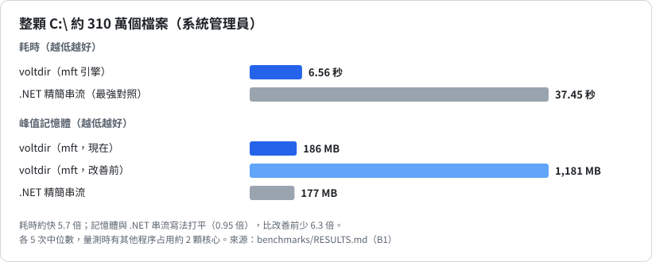
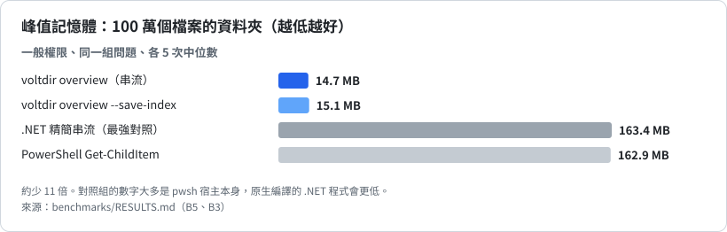
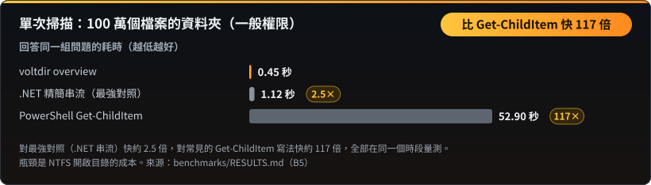
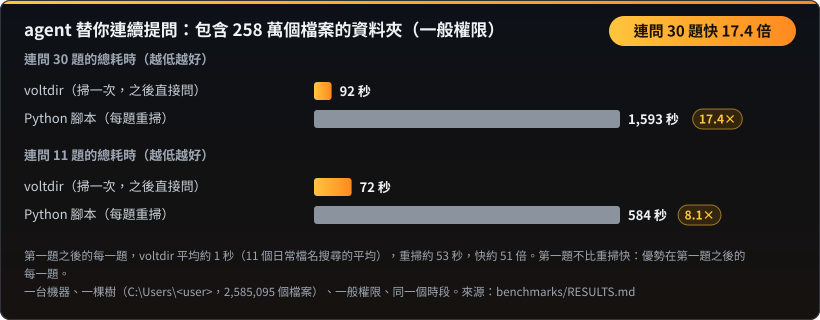

<p align="center"></p>

**閱讀語言：** [English](README.md) · 正體中文 · [简体中文](README.zh-CN.md) · [한국어](README.ko.md) · [日本語](README.ja.md) · [Tiếng Việt](README.vi.md)

**掃描一次，之後想問幾題都可以，每題約一秒。**

**給 AI agent 用的 Windows 磁碟分析工具。** 一次呼叫看懂一顆硬碟：哪裡最大、什麼副檔名最多、哪裡有空檔案、這幾天多了什麼。唯讀、單一執行檔、輸出固定格式的 JSON。

| 整顆 `C:\`（系統管理員） | 記憶體，100 萬個檔案 | 單次掃描，100 萬個檔案 | agent 連續提問 |
|:---:|:---:|:---:|:---:|
| **快 5.7 倍**<br>6.6 秒對 37.5 秒 | **少 11 倍**<br>14 MB 對 163 MB | **最高快 117 倍**<br>比 Get-ChildItem；比最強的 .NET 寫法快 2.5 倍 | **快 17.4 倍**<br>連問 30 題，每題約 1 秒 |

> **第一題和任何掃描一樣慢。** voltdir 要先掃描資料夾並建立索引，這部分用心寫的 Python 腳本不會更慢（258 萬個檔案時是 0.9 倍）。優勢在第一題之後的每一題。還沒贏的地方列在下面。

**整顆 `C:\`（系統管理員）：快 5.7 倍，6.6 秒對 37.5 秒。**



**記憶體，100 萬個檔案的資料夾：少用約 11 倍。**



**單次掃描 100 萬個檔案的資料夾：比常見的 Get-ChildItem 寫法最高快 117 倍，比最強的 .NET 寫法快 2.5 倍。**



**agent 替你連續提問：連問 30 題快 17.4 倍，每題約 1 秒。**



數字量自真實資料夾，對照的是寫得用心的基準做法。每個數字（**包含還沒贏的地方**）都在 [`benchmarks/RESULTS.md`](benchmarks/RESULTS.md)，所有圖表在[基準結果頁](BENCHMARKS.zh-TW.md)，[`benchmarks/`](benchmarks/README.md) 的腳本可以在你自己的機器上重現。

- **唯讀：** 只讀名稱、大小、時間與屬性；不讀檔案內容、不刪除、不搬移、不連網、不自己提權。
- **單一 `voltdir.exe`**（x64，約 0.75 MB）：靜態連結 C 執行階段，只匯入 Windows 內建的 DLL，不用另外安裝任何相依套件。
- **給 agent 的 skill：** [`skills/voltdir/SKILL.md`](skills/voltdir/SKILL.md)（約 5,600 字元），附建置好的執行檔，第一步一律是 `overview`。
- 狀態：**v1 候選**，只支援 Windows x64。

## 用大白話說就好

你不需要寫任何搜尋語法。你跟 agent 說想做什麼，它會把話轉成搜尋，voltdir 從索引回答，完全不讀任何檔案的內容。

| 你說 | voltdir 找出 |
|---|---|
| 「LINE、微信一直自動下載 PDF，幫我全部找出來分類整理」 | 你指定的每一顆磁碟（`C:`、`F:` 都行）上的所有 PDF：各來自哪裡（聊天軟體的資料夾、下載、桌面）、放了多久、多大、哪些像發票或合約、哪些是重複的，整理成清單供你決定 |
| 「幫我整理手機匯進來的照片」 | 相機與手機拍的照片（`IMG_0001.JPG`、`PXL_…heic`），附上所在資料夾、大小與日期 |
| 「幫我清一下螢幕截圖」 | 所有名稱像 `螢幕擷取畫面 2026-01-02.png` 的檔案，不管存在哪裡 |
| 「下載資料夾是不是一堆重複的？」 | 像 `報告 (1).pdf`、`報告 - 複本.docx` 這樣的副本，以候選清單呈現 |
| 「有什麼可以放心清掉？」 | 殘留的暫存檔（`.bak`、`.old`、`.tmp`、沒下載完的檔案）、舊安裝檔與空資料夾，附大小與年齡。這是給你決定的清單，voltdir 不會刪任何東西 |
| 「報稅要用，幫我找發票」 | 名稱含「發票」「收據」的檔案，不會開啟任何檔案 |
| 「我電腦裡有幾個專案？」 | 含有 `package.json`、`Cargo.toml`、`pyproject.toml` 或 `go.mod` 的資料夾 |

agent 實際使用的搜尋樣式都經過測試，列在 [`skills/voltdir/reference.md`](skills/voltdir/reference.md)。

### 聊天軟體自動下載的 PDF

LINE、微信（WeChat）、Telegram 這類聊天軟體，會把收到的每一份 PDF 存進自己的資料夾，多數人從來不會去看。在一台真實的電腦上，磁碟裡 728 個 PDF 中有 371 個躺在微信的資料夾裡。掃描一次之後依序問：有多少個、多大；各來自哪個軟體；哪些放了超過一年；哪些像發票或合約；哪些是重複下載。這樣的七個問題，掃描之後總共只花 1.25 秒，因為 PDF 的搜尋用的是副檔名，不是檔名樣式。接著由你的 agent 提出資料夾結構與搬移清單；voltdir 只讀名稱，在你點頭之前不會開啟、搬動或刪除任何檔案。

## 為 agent 而做

- **會說它沒看到什麼。** 讀不到的資料夾列在 `coverage`，結束代碼是 2，所以不完整的答案不會被當成完整。
- **不會被話術帶著走。** 檔名只是資料。控制字元與右到左的偽裝都會被跳脫，一個叫「忽略先前的指示……」的檔案仍然只是檔名。
- **會說答案有多新。** stderr 有 `index: used (built 12 minutes ago)`。
- **任何 agent 都找得到它。** 有 Claude skill 與外掛，也有給會讀 [`AGENTS.md`](AGENTS.md) 的 agent 用的檔案。就是一般命令列，不需要常駐任何服務。

---

## 安裝

### 當成 Claude Code 外掛

```text
/plugin marketplace add CubeLink-oss/voltdir
/plugin install voltdir@voltdir
```

外掛內含 skill 與建置好的 `voltdir.exe`（[`skills/voltdir/bin/`](skills/voltdir/bin)）。遇到「硬碟為什麼滿了」「找出大檔案」「這禮拜多了什麼」這類問題，agent 會自動使用。

### 直接用執行檔

把 [`skills/voltdir/bin/voltdir.exe`](skills/voltdir/bin) 複製到任何資料夾就能用，不需要安裝。執行檔目前還沒有程式碼簽章，第一次執行時 Windows 可能跳出 SmartScreen 警告。執行前可以先確認它確實由這份原始碼建置，見[核對附帶的執行檔](#核對附帶的執行檔)。

---

## 快速開始

```powershell
# 第一個呼叫：總量、最大的資料夾與檔案、副檔名、久未修改的大檔、空檔案，
# 並附上可直接執行的 next 命令
voltdir overview D:\Projects

# 同一次掃描順便存下精簡索引，之後追問不必重掃
voltdir overview D:\Projects --save-index C:\Temp\p.idx
voltdir report --index C:\Temp\p.idx --top-dirs 20 --by-ext 15

# 要用 find 或 diff 時才存完整快照；它也會寫名稱索引，之後每次 find --snapshot 都不到一秒
# （舊快照用 voltdir index 檔案 補建索引）
voltdir overview D:\Projects --save-snapshot C:\Temp\p.ndjson
voltdir find --snapshot C:\Temp\p.ndjson --ext .log --min-size 100M --sort size --limit 20
voltdir diff C:\Temp\monday.ndjson C:\Temp\friday.ndjson --match-roots
```

掃整顆磁碟請**以系統管理員身分**開 PowerShell，voltdir 才能用直接讀取 NTFS 主檔案表（MFT）的 `mft` 引擎。一般權限會自動改用 `walk` 引擎，部分系統資料夾會讀不到，輸出的 `coverage` 會逐一列出。

---

## 基準結果

所有圖表（記憶體、整顆磁碟、agent 連續追問、單次掃描、對比一般 Python 腳本）都在**[基準結果頁](BENCHMARKS.zh-TW.md)**，數字在 [`benchmarks/RESULTS.md`](benchmarks/RESULTS.md)。

### 還沒贏的地方

| 項目 | 現況 |
|---|---|
| 第一題 | 在一般權限的掃描上，不比寫得用心的 Python 腳本快；兩者都在等同樣的 NTFS 開啟目錄成本（258 萬個檔案時是 0.9 倍）。優勢在第一題之後。 |
| 正規表示式搜尋 | 有多個選項的搜尋在 258 萬個名稱上約 2 秒；比對器還沒有最佳化。 |
| 一般權限的單次掃描 | 100 萬個檔案比最強的 .NET 對照組快約 2.5 倍；整顆 `C:\` 反而較慢（0.78 倍）。瓶頸在 NTFS 開啟目錄的成本 |
| token 用量 | 與對照組相近，voltdir 組多用 4% 到 10%。每次 agent 呼叫有約 7.3 萬 token 的固定開銷，任何工具都省不掉 |
| 提權整碟的記憶體 | 186 MB，與 .NET 串流寫法（177 MB）打平，沒有領先 |

原因說明見 [`benchmarks/RESULTS.md`](benchmarks/RESULTS.md)。

## 做得好的地方，以及要留意的地方

**做得好的地方**

- **可以信任的計數。** 有處理 junction 與硬連結，總量和實際相符（見[基準結果頁](BENCHMARKS.zh-TW.md)）。
- **不會悄悄漏掉。** 有資料夾讀不到時，結束代碼是 2，`coverage` 會逐一列出。
- **追問很便宜。** 有索引之後，每個問題約 0.05 秒。
- **輸出穩定。** 同一份輸入、同一個引擎，輸出的 JSON 逐位元組相同。

**由獨立評測找出，已在 0.0.2 修好。** 我們用 agent 實際會用的方式測試 voltdir，把確定是 bug 的都修掉了：

- 樣式用正斜線（`--exclude "*/node_modules/*"`、`--path "*/src/*"`）以前什麼都比對不到，而且悄悄地：命令成功、什麼都沒排除。現在每個樣式裡的 `/` 和 `\` 意思相同。
- `--exclude` 的樣式沒命中任何路徑時，現在會在 stderr 印出警告，打錯字不會再沒人發現。
- 每個命令都接受 `--json`（沒有任何作用，輸出本來就是 JSON），也接受 `--follow-links none`（那就是預設）。
- `--help` 現在說明整顆磁碟結束代碼 2 是正常的，以及 `mft` 引擎需要什麼。

**要知道的事**（設計如此，不是 bug）：

| 行為 | 原因 | 怎麼做 |
|---|---|---|
| `find --snapshot ... --exclude` 會報錯 | 掃描選項只在掃描時有效，讀快照時無效 | 掃描時就排除（`scan --exclude`），或用 `--path` 篩選 |
| 整顆磁碟的掃描結束代碼是 2 | 資源回收筒等系統資料夾讀不到；結果有效，`coverage` 會列出 | 在腳本裡把 2 當成「完成但有警告」，不要當成失敗 |
| `find --limit` 依路徑順序保留前幾筆（預設 100） | 沒有另外指定時，結果依路徑排序 | 用 `--sort size`，並比對 `matched_total` 與清單筆數 |
| 速度優勢跟樹的形狀有關 | 100 萬個檔案的資料夾比 Python 迴圈快約 5 倍；開發工作區或整顆磁碟約 2 倍（見[基準結果頁](BENCHMARKS.zh-TW.md)） | 在你自己的資料夾上跑一次基準 |

---

## 子命令

| 命令 | 用途 | 輸出 |
|---|---|---|
| `overview <PATH>... \| --snapshot <FILE> \| --index <FILE>` | **一次回答常見問題**（約 3 KB）：總量、最大的資料夾與檔案、副檔名分佈、久未修改的大檔、空檔案與空資料夾、沒讀到的位置，以及可直接執行的 `next` 命令。選項：`--save-index`、`--save-snapshot`、`--rank physical\|logical`、`--dir-rank rollup\|direct`、`--detail concise\|full` | 單一 JSON（`voltdir.overview/1`） |
| `report <PATH>... \| --snapshot <FILE> \| --index <FILE>` | 直接彙總：`--top-files`、`--top-dirs`、`--by-ext`、`--many-files` | 單一 JSON（`voltdir.report/1`） |
| `find <PATH>... \| --snapshot <FILE>` | 依名稱（萬用字元或 `--name-regex`）、路徑、類型、副檔名、大小、日期、是否為空來搜尋 | 單一 JSON（`voltdir.find/1`） |
| `diff <A> <B>` | 比較兩份快照：變大、變小、新增、消失。兩份快照路徑不同時加 `--match-roots`（或 `--a-root`／`--b-root`） | 單一 JSON（`voltdir.diff/1`） |
| `scan <PATH>... --out <FILE>` | 只輸出**快照**。快照可能有數百 MB，所以 `--out` 必填；要輸出到標準輸出請明確寫 `--out -` | NDJSON（`voltdir.snapshot/1`） |
| `info` | 環境與能力：版本、是否提權、可用引擎、磁碟區 | 單一 JSON |

常用選項：`--out <FILE|->`、`--engine auto|mft|walk`、`--threads <N>`、`--exclude <GLOB>`、`--follow-links mount|symlink|junction`、`--hardlinks dedupe|none`、`--timeout-sec <N>`、`-q`。完整語法請執行 `voltdir --help` 或 `voltdir help <子命令>`。

## 兩個引擎

| | `walk` | `mft` |
|---|---|---|
| 需要系統管理員 | 否 | **是**（讀取磁碟區的 MFT） |
| 範圍 | 任何資料夾、任何檔案系統 | 只有本機 NTFS 磁碟機的**根**，例如 `C:\` |
| 整顆 `C:\`（約 310 萬個檔案） | 約 54 秒 | **約 6.6 秒、峰值 186 MB** |
| 看得到的範圍 | 受權限限制；看不到 `$MFT` 等保留項目 | 看得到保留項目（標記 `reserved: true`）與 `System Volume Information` 的內容 |

`--engine auto`（預設）在條件符合時用 `mft`，否則改用 `walk` 並在 stderr 說明原因；`--engine mft` 是嚴格模式，無法使用時以結束代碼 3 結束。

## 結束代碼

| 代碼 | 意義 |
|---|---|
| 0 | 完整成功 |
| 1 | 用法錯誤，包括無法使用的快照或索引，以及 `diff` 的兩份快照根目錄不重疊卻沒加 `--match-roots` |
| 2 | 結果有效，但**有部分資料夾沒讀到**（多半是存取被拒）；`coverage` 會列出位置，**不可當成完整結果** |
| 3 | 指定的引擎無法使用（例如未提權卻指定 `--engine mft`，或磁碟區不是 NTFS） |
| 4 | 輸出檔寫入失敗（不會留下寫到一半的檔案） |
| 5 | 逾時或被取消（已掃描的部分仍會輸出） |

## 輸出格式要點

- 路徑為 Win32 形式，不帶 `\\?\` 前綴；不成對的 UTF-16 代理字元以 `\uXXXX` 跳脫，不會遺失。控制字元與雙向文字字元一律跳脫，避免有人用特製的檔名對 agent 做提示注入。
- 時間為 UTC 的 RFC 3339 格式；大小為以位元組為單位的整數。`size_logical` 是檔案結尾位置，`size_physical` 是磁碟上實際配置的空間。
- 順序固定：同一份輸入、同一個引擎，輸出逐位元組相同。
- **硬連結**的實際大小只算一次；邏輯大小則每個名稱各算一次。

## 建置與檢查

需要 Rust 1.94 以上（MSVC 工具鏈）。

```powershell
cargo build --release          # 產出 target\release\voltdir.exe
.\scripts\ci.ps1               # 格式、clippy、全部測試、授權檢查、基準腳本自我測試、skill 檢查
```

重現基準的步驟見 [`benchmarks/README.md`](benchmarks/README.md)。

## 核對附帶的執行檔

[`skills/voltdir/bin/`](skills/voltdir/bin) 裡的 `voltdir.exe` 不是另外來的檔案，而是用 `cargo build --release` 從本倉庫的原始碼建置；SHA-256 雜湊值就記在旁邊的 `voltdir.exe.sha256`。建置過程是確定性的：連結器加上 `/Brepro`，執行檔裡不含時間戳記，也不含建置機器上的路徑。同一個 commit、同一套工具鏈，建出來的位元組完全相同。

公開的執行檔以 **Rust 1.94.0**（`x86_64-pc-windows-msvc`）建置。自己核對的步驟：

```powershell
git clone https://github.com/CubeLink-oss/voltdir
cd voltdir
rustup toolchain install 1.94.0
cargo +1.94.0 build --release
(Get-FileHash target\release\voltdir.exe -Algorithm SHA256).Hash
Get-Content skills\voltdir\bin\voltdir.exe.sha256
```

兩個雜湊值應該相同（前者以大寫顯示）。如果不同，請確認 commit 一致、`rustc +1.94.0 -V` 顯示 1.94.0；MSVC 連結器的版本不同也可能讓位元組不一樣。如果你不想執行不是自己建置的檔案，改用你自己的 `target\release\voltdir.exe` 即可；skill 也接受已在 `PATH` 上的 `voltdir`。

有些安全掃描器只要看到 skill 附帶執行檔就會發出警告。這在預期之內，上面的步驟就是讓你自行確認的方法。

## 倉庫內容

| 位置 | 內容 |
|---|---|
| [`skills/voltdir/`](skills/voltdir) | 給 agent 的 skill：[`SKILL.md`](skills/voltdir/SKILL.md)、完整參考 [`reference.md`](skills/voltdir/reference.md)、建置好的 `bin/voltdir.exe` |
| [`.claude-plugin/`](.claude-plugin) | Claude Code 外掛與外掛市集設定 |
| [`benchmarks/`](benchmarks/README.md) | 可重現的基準腳本與[結果摘要](benchmarks/RESULTS.md) |
| `src/`、`tests/` | 原始碼與測試 |
| `scripts/` | CI、授權檢查、測試資料產生器 |

## 隱私

voltdir 完全在你的電腦上執行。它只讀取名稱、大小、時間與屬性（不讀檔案內容），不建立任何網路連線，也不蒐集任何資料。它只寫入你用 `--out`、`--save-index`、`--save-snapshot` 指定的檔案；這些檔案含有檔案路徑，請當成敏感資料保管。由 AI agent 執行 voltdir 時，agent 會讀到輸出內容，成為它與你對話的一部分。隨附的 skill 會要求 agent 在掃描整顆磁碟、個人資料夾或看起來涉及私人內容的資料夾之前先向你確認，除非是你自己指名的資料夾。完整說明見 [`PRIVACY.md`](PRIVACY.md)（英文）。問題與錯誤回報：[GitHub Issues](https://github.com/CubeLink-oss/voltdir/issues)。

## 授權

[Apache License 2.0](LICENSE)，著作權人見 [`NOTICE`](NOTICE)。
