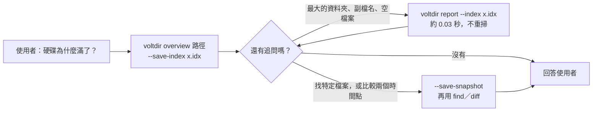
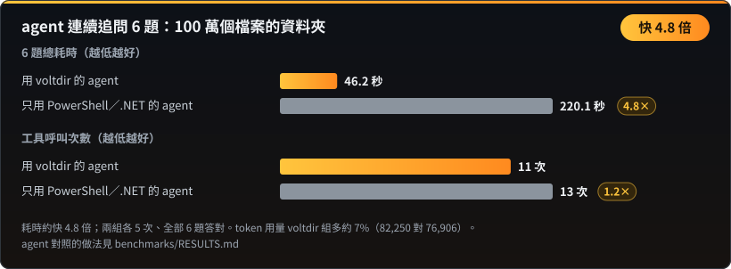

<p align="center"></p>

**閱讀語言：** [English](README.md) · 正體中文 · [简体中文](README.zh-CN.md) · [한국어](README.ko.md) · [日本語](README.ja.md) · [Tiếng Việt](README.vi.md)

**給 AI agent 用的 Windows 磁碟分析工具。** 一次呼叫看懂一顆硬碟：哪裡最大、什麼副檔名最多、哪裡有空檔案、這幾天多了什麼。唯讀、單一執行檔、輸出固定格式的 JSON。

| 100 萬個檔案的資料夾 | 整顆 `C:\`（系統管理員） | agent 連續追問 6 題 |
|:---:|:---:|:---:|
| 記憶體 **約少 11 倍**<br>14.7 MB 對 163 MB | 耗時 **約快 5.7 倍**<br>6.6 秒對 37.5 秒 | 耗時 **約快 4.8 倍**<br>46 秒對 220 秒 |

對照組都是寫得好的 PowerShell／.NET，取最強的一個；各 5 次取中位數。完整數字與**還沒贏的地方**見 [`benchmarks/RESULTS.md`](benchmarks/RESULTS.md)，用 [`benchmarks/`](benchmarks/README.md) 的腳本可以在你的機器上重跑。

- **唯讀：** 只讀名稱、大小、時間與屬性；不讀檔案內容、不刪除、不搬移、不連網、不自己提權。
- **單一 `voltdir.exe`**（x64，約 0.75 MB）：靜態連結 C 執行階段，只匯入 Windows 內建的 DLL，不用另外安裝任何相依套件。
- **給 agent 的 skill：** [`skills/voltdir/SKILL.md`](skills/voltdir/SKILL.md)（約 4,500 字元），附建置好的執行檔，第一步一律是 `overview`。
- 狀態：**v1 候選**，只支援 Windows x64。

---

## 安裝

### 當成 Claude Code 外掛

```text
/plugin marketplace add CubeLink-oss/voltdir
/plugin install voltdir@voltdir
```

外掛內含 skill 與建置好的 `voltdir.exe`（[`skills/voltdir/bin/`](skills/voltdir/bin)）。遇到「硬碟為什麼滿了」「找出大檔案」「這禮拜多了什麼」這類問題，agent 會自動使用。

### 直接用執行檔

把 [`skills/voltdir/bin/voltdir.exe`](skills/voltdir/bin) 複製到任何資料夾就能用，不需要安裝。執行檔目前還沒有程式碼簽章，第一次執行時 Windows 可能跳出 SmartScreen 警告。執行前可以先確認它確實由這份原始碼建置，見[核對附帶的執行檔](#核對附帶的執行檔)。

---

## 快速開始

```powershell
# 第一個呼叫：總量、最大的資料夾與檔案、副檔名、久未修改的大檔、空檔案，
# 並附上可直接執行的 next 命令
voltdir overview D:\Projects

# 同一次掃描順便存下精簡索引，之後追問不必重掃
voltdir overview D:\Projects --save-index C:\Temp\p.idx
voltdir report --index C:\Temp\p.idx --top-dirs 20 --by-ext 15

# 要用 find 或 diff 時才存完整快照
voltdir overview D:\Projects --save-snapshot C:\Temp\p.ndjson
voltdir find --snapshot C:\Temp\p.ndjson --ext .log --min-size 100M --sort size --limit 20
voltdir diff C:\Temp\monday.ndjson C:\Temp\friday.ndjson --match-roots
```

掃整顆磁碟請**以系統管理員身分**開 PowerShell，voltdir 才能用直接讀取 NTFS 主檔案表（MFT）的 `mft` 引擎。一般權限會自動改用 `walk` 引擎，部分系統資料夾會讀不到，輸出的 `coverage` 會逐一列出。

### agent 怎麼用它



---

## 基準結果

以下數字都來自 `benchmarks\` 裡可重現的基準。每格各跑 5 次取中位數；量測時若有背景程序占用 CPU，會標註雜訊警告。

### 記憶體：100 萬個檔案的資料夾


voltdir 邊走邊彙總：資料夾走完就併進上一層，不保留每個檔案的紀錄。對照組的 163 MB 大多是 `pwsh` 宿主本身，原生編譯的 .NET 程式會更低。

### 整顆 C:\（系統管理員）


### agent 連續追問



同一個模型、同一組題目、同樣的權限，兩組各跑 5 次，全部答對。差距來自追問：存好索引後，每個追問約 3 到 8 秒；對照組每個追問要花 7 到 33 秒重算。agent 層級的對照需要 agent 執行環境，做法寫在 [`benchmarks/RESULTS.md`](benchmarks/RESULTS.md)。

### 還沒贏的地方


| 項目 | 現況 |
|---|---|
| 一般權限的單次掃描 | 100 萬個檔案只比最強的 .NET 對照組快約 1.7 倍；整顆 `C:\` 反而較慢（0.78 倍）。瓶頸在 NTFS 開啟目錄的成本 |
| token 用量 | 與對照組相近，voltdir 組多用 4% 到 10%。每次 agent 呼叫有約 7.3 萬 token 的固定開銷，任何工具都省不掉 |
| 提權整碟的記憶體 | 186 MB，與 .NET 串流寫法（177 MB）打平，沒有領先 |

原因說明見 [`benchmarks/RESULTS.md`](benchmarks/RESULTS.md)。

---

## 子命令

| 命令 | 用途 | 輸出 |
|---|---|---|
| `overview <PATH>... \| --snapshot <FILE> \| --index <FILE>` | **一次回答常見問題**（約 3 KB）：總量、最大的資料夾與檔案、副檔名分佈、久未修改的大檔、空檔案與空資料夾、沒讀到的位置，以及可直接執行的 `next` 命令。選項：`--save-index`、`--save-snapshot`、`--rank physical\|logical`、`--dir-rank rollup\|direct`、`--detail concise\|full` | 單一 JSON（`voltdir.overview/1`） |
| `report <PATH>... \| --snapshot <FILE> \| --index <FILE>` | 直接彙總：`--top-files`、`--top-dirs`、`--by-ext`、`--many-files` | 單一 JSON（`voltdir.report/1`） |
| `find <PATH>... \| --snapshot <FILE>` | 依名稱（萬用字元或 `--name-regex`）、路徑、類型、副檔名、大小、日期、是否為空來搜尋 | 單一 JSON（`voltdir.find/1`） |
| `diff <A> <B>` | 比較兩份快照：變大、變小、新增、消失。兩份快照路徑不同時加 `--match-roots`（或 `--a-root`／`--b-root`） | 單一 JSON（`voltdir.diff/1`） |
| `scan <PATH>... --out <FILE>` | 只輸出**快照**。快照可能有數百 MB，所以 `--out` 必填；要輸出到標準輸出請明確寫 `--out -` | NDJSON（`voltdir.snapshot/1`） |
| `info` | 環境與能力：版本、是否提權、可用引擎、磁碟區 | 單一 JSON |

常用選項：`--out <FILE|->`、`--engine auto|mft|walk`、`--threads <N>`、`--exclude <GLOB>`、`--follow-links mount|symlink|junction`、`--hardlinks dedupe|none`、`--timeout-sec <N>`、`-q`。完整語法請執行 `voltdir --help` 或 `voltdir help <子命令>`。

## 兩個引擎

| | `walk` | `mft` |
|---|---|---|
| 需要系統管理員 | 否 | **是**（讀取磁碟區的 MFT） |
| 範圍 | 任何資料夾、任何檔案系統 | 只有本機 NTFS 磁碟機的**根**，例如 `C:\` |
| 整顆 `C:\`（約 310 萬個檔案） | 約 54 秒 | **約 6.6 秒、峰值 186 MB** |
| 看得到的範圍 | 受權限限制；看不到 `$MFT` 等保留項目 | 看得到保留項目（標記 `reserved: true`）與 `System Volume Information` 的內容 |

`--engine auto`（預設）在條件符合時用 `mft`，否則改用 `walk` 並在 stderr 說明原因；`--engine mft` 是嚴格模式，無法使用時以結束代碼 3 結束。

## 結束代碼

| 代碼 | 意義 |
|---|---|
| 0 | 完整成功 |
| 1 | 用法錯誤，包括無法使用的快照或索引，以及 `diff` 的兩份快照根目錄不重疊卻沒加 `--match-roots` |
| 2 | 結果有效，但**有部分資料夾沒讀到**（多半是存取被拒）；`coverage` 會列出位置，**不可當成完整結果** |
| 3 | 指定的引擎無法使用（例如未提權卻指定 `--engine mft`，或磁碟區不是 NTFS） |
| 4 | 輸出檔寫入失敗（不會留下寫到一半的檔案） |
| 5 | 逾時或被取消（已掃描的部分仍會輸出） |

## 輸出格式要點

- 路徑為 Win32 形式，不帶 `\\?\` 前綴；不成對的 UTF-16 代理字元以 `\uXXXX` 跳脫，不會遺失。控制字元與雙向文字字元一律跳脫，避免有人用特製的檔名對 agent 做提示注入。
- 時間為 UTC 的 RFC 3339 格式；大小為以位元組為單位的整數。`size_logical` 是檔案結尾位置，`size_physical` 是磁碟上實際配置的空間。
- 順序固定：同一份輸入、同一個引擎，輸出逐位元組相同。
- **硬連結**的實際大小只算一次；邏輯大小則每個名稱各算一次。

## 建置與檢查

需要 Rust 1.94 以上（MSVC 工具鏈）。

```powershell
cargo build --release          # 產出 target\release\voltdir.exe
.\scripts\ci.ps1               # 格式、clippy、全部測試、授權檢查、基準腳本自我測試、skill 檢查
```

重現基準的步驟見 [`benchmarks/README.md`](benchmarks/README.md)。

## 核對附帶的執行檔

[`skills/voltdir/bin/`](skills/voltdir/bin) 裡的 `voltdir.exe` 不是另外來的檔案，而是用 `cargo build --release` 從本倉庫的原始碼建置；SHA-256 雜湊值就記在旁邊的 `voltdir.exe.sha256`。建置過程是確定性的：連結器加上 `/Brepro`，執行檔裡不含時間戳記，也不含建置機器上的路徑。同一個 commit、同一套工具鏈，建出來的位元組完全相同。

公開的執行檔以 **Rust 1.94.0**（`x86_64-pc-windows-msvc`）建置。自己核對的步驟：

```powershell
git clone https://github.com/CubeLink-oss/voltdir
cd voltdir
rustup toolchain install 1.94.0
cargo +1.94.0 build --release
(Get-FileHash target\release\voltdir.exe -Algorithm SHA256).Hash
Get-Content skills\voltdir\bin\voltdir.exe.sha256
```

兩個雜湊值應該相同（前者以大寫顯示）。如果不同，請確認 commit 一致、`rustc +1.94.0 -V` 顯示 1.94.0；MSVC 連結器的版本不同也可能讓位元組不一樣。如果你不想執行不是自己建置的檔案，改用你自己的 `target\release\voltdir.exe` 即可；skill 也接受已在 `PATH` 上的 `voltdir`。

有些安全掃描器只要看到 skill 附帶執行檔就會發出警告。這在預期之內，上面的步驟就是讓你自行確認的方法。

## 倉庫內容

| 位置 | 內容 |
|---|---|
| [`skills/voltdir/`](skills/voltdir) | 給 agent 的 skill：[`SKILL.md`](skills/voltdir/SKILL.md)、完整參考 [`reference.md`](skills/voltdir/reference.md)、建置好的 `bin/voltdir.exe` |
| [`.claude-plugin/`](.claude-plugin) | Claude Code 外掛與外掛市集設定 |
| [`benchmarks/`](benchmarks/README.md) | 可重現的基準腳本與[結果摘要](benchmarks/RESULTS.md) |
| `src/`、`tests/` | 原始碼與測試 |
| `scripts/` | CI、授權檢查、測試資料產生器 |

## 授權

[Apache License 2.0](LICENSE)，著作權人見 [`NOTICE`](NOTICE)。
